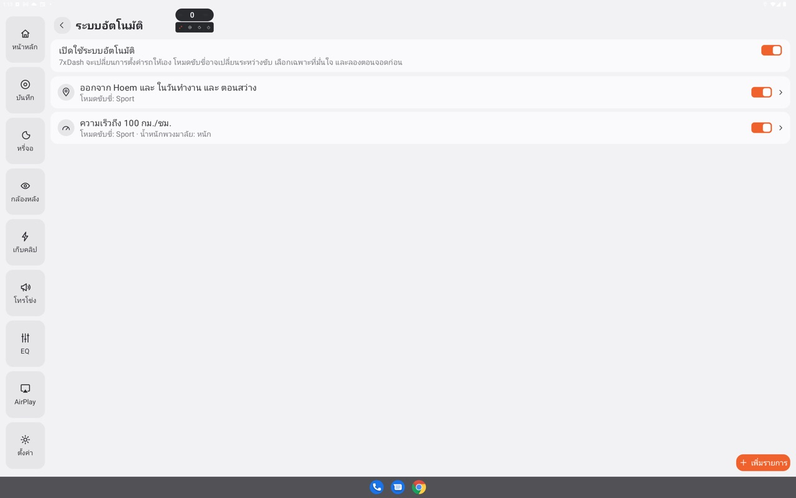
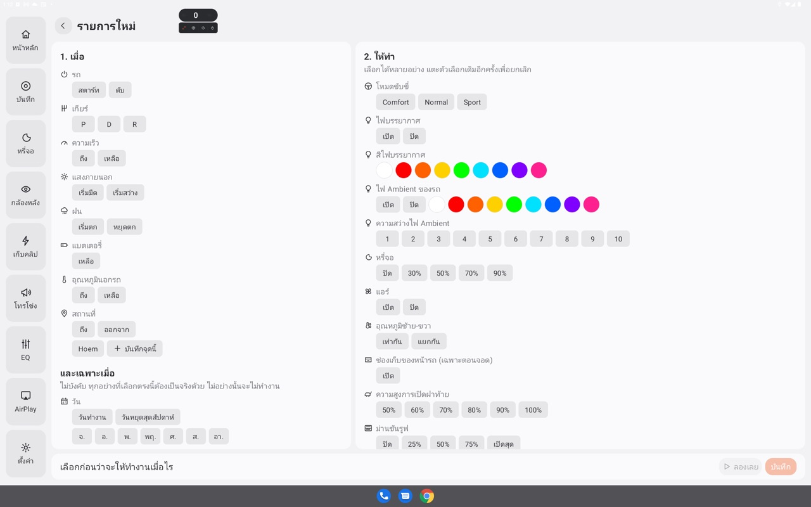
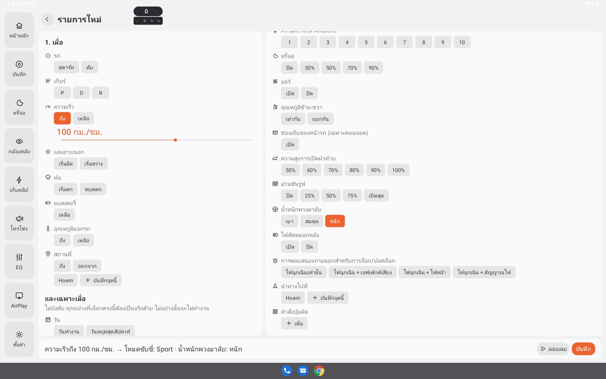
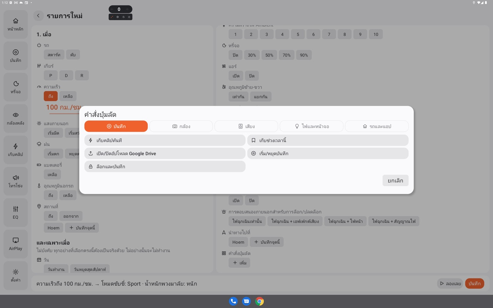

# ระบบอัตโนมัติ (Automation) แบบเจาะลึก

ระบบอัตโนมัติให้ 7xDash เปลี่ยนการตั้งค่ารถเองเมื่อมีเหตุการณ์ที่คุณเลือก
เช่น "ฝนเริ่มตก ตอนมืด → เปิดไฟตัดหมอกหลัง" หรือ "ออกจากบ้าน ในวันทำงาน → นำทางไปที่ทำงาน"

[← กลับไปคู่มือฟีเจอร์ทั้งหมด](features.md)

> 7xDash จะเปลี่ยนการตั้งค่ารถให้เองระหว่างขับ เช่น โหมดขับขี่ ให้เลือกเฉพาะสิ่งที่มั่นใจ
> และ **ลองตอนจอดก่อนทุกครั้ง** ด้วยปุ่ม **ลองเลย**

---

## สารบัญ

- [หลักการทำงาน](#หลักการทำงาน)
- [สร้างรายการแรก](#สร้างรายการแรก)
- [1. เมื่อ: เหตุการณ์ที่เลือกได้](#1-เมื่อ-เหตุการณ์ที่เลือกได้)
- [และเฉพาะเมื่อ: เงื่อนไขเพิ่มเติม](#และเฉพาะเมื่อ-เงื่อนไขเพิ่มเติม)
- [2. ให้ทำ: คำสั่งที่เลือกได้](#2-ให้ทำ-คำสั่งที่เลือกได้)
- [สถานที่ (บ้าน ที่ทำงาน…)](#สถานที่-บ้าน-ที่ทำงาน)
- [กฎที่ควรรู้](#กฎที่ควรรู้)
- [ตัวอย่างที่ใช้จริง](#ตัวอย่างที่ใช้จริง)
- [แก้ปัญหา](#แก้ปัญหา)

---

## หลักการทำงาน

แต่ละรายการมี 3 ส่วน อ่านเป็นประโยคเดียวได้:

```
เมื่อ  [เหตุการณ์ 1 อย่าง]   และเฉพาะเมื่อ  [เงื่อนไข 0–4 อย่าง]   →   ให้ทำ  [คำสั่งกี่อย่างก็ได้ ตามลำดับ]
```

- **เมื่อ** คือ *การเปลี่ยนแปลง* เช่น "เข้าเกียร์ D", "ฝนเริ่มตก", "ออกจากบ้าน"
- **และเฉพาะเมื่อ** คือ *สภาพตอนนั้น* เช่น "ตอนมืด", "ในวันทำงาน", "อยู่ที่บ้าน" ไม่ใส่ก็ได้
- **ให้ทำ** คือสิ่งที่ 7xDash จะสั่งรถ ทำต่อกันตามลำดับจากบนลงล่าง

ตัวอย่าง: `เริ่มมืด และฝนตกอยู่ → ไฟตัดหมอกหลัง: เปิด · หรี่จอ: 50%`

เมื่อรายการทำงาน จะมีข้อความขึ้นบนจอ เช่น "ระบบอัตโนมัติ: ไฟตัดหมอกหลัง: เปิด"
ถ้าบางคำสั่งทำไม่สำเร็จ จะขึ้นว่า "ทำงานไม่ครบ: …" พร้อมเหตุผล และแต่ละรายการจะแสดง "ทำงานล่าสุด …"


*รายการระบบอัตโนมัติ: สวิตช์ เปิดใช้ระบบอัตโนมัติ ด้านบน และสวิตช์ของแต่ละรายการ*


---

## สร้างรายการแรก

1. แตะการ์ด **ระบบอัตโนมัติ** ในหน้าหลัก
2. เปิดสวิตช์ **เปิดใช้ระบบอัตโนมัติ** (ถ้าปิดอยู่ ทุกรายการจะไม่ทำงาน)
3. กด **เพิ่มรายการ** หรือแตะตัวอย่างที่แอปเตรียมไว้ แล้วแก้ต่อ
4. **1. เมื่อ** (ฝั่งซ้าย): เลือกเหตุการณ์ ถ้าเป็นตัวเลข เช่น ความเร็ว ให้เลือกค่าด้วย
5. **และเฉพาะเมื่อ** (ไม่บังคับ): เลือกเงื่อนไขเพิ่ม
6. **2. ให้ทำ** (ฝั่งขวา): แตะคำสั่งและตัวเลือก เลือกได้หลายอย่าง แตะตัวเลือกเดิมอีกครั้งเพื่อเอาออก
7. ดูประโยคด้านล่างที่อ่านทวนสิ่งที่ตั้งไว้ แล้วกด **ลองเลย** ตอนจอด เพื่อดูว่ารถทำตามจริง
8. บันทึก


*หน้า รายการใหม่: 1. เมื่อ ทางซ้าย 2. ให้ทำ ทางขวา ประโยคสรุปด้านล่าง*


แตะรายการเดิมเพื่อแก้ไข หรือลบได้จากหน้าแก้ไข

**ตัวอย่างสำเร็จรูป** (ขึ้นตอนยังไม่มีรายการ):
- ออกจาก [สถานที่แรกที่บันทึกไว้] → ความสูงการเปิดฝาท้าย 50%
- ฝนเริ่มตก ตอนมืด → ไฟตัดหมอกหลัง: เปิด
- เริ่มมืด → ไฟบรรยากาศ: เปิด

---

## 1. เมื่อ: เหตุการณ์ที่เลือกได้

| กลุ่ม | เหตุการณ์ | ค่าที่เลือกได้ |
|---|---|---|
| รถ | **สตาร์ทรถ**, **ดับรถ** | |
| เกียร์ | **เข้าเกียร์ P**, **เข้าเกียร์ D**, **เข้าเกียร์ R** | |
| ความเร็ว | **ความเร็วถึง** … / **ความเร็วลดเหลือ** … | 10–160 กม./ชม. ทีละ 10 |
| แสงภายนอก | **เริ่มมืด**, **เริ่มสว่าง** (ตามเซนเซอร์กลางวัน/กลางคืนของรถ) | |
| ฝน | **ฝนเริ่มตก**, **ฝนหยุดตก** (ตามเซนเซอร์ฝนของรถ) | |
| แบตเตอรี่ | **แบตเหลือ** … | 5–50% ทีละ 5 |
| อุณหภูมินอกรถ | **อุณหภูมินอกรถถึง** … / **ลดเหลือ** … | −10 ถึง 40 °C ทีละ 5 |
| สถานที่ | **ถึง** [สถานที่], **ออกจาก** [สถานที่] | สถานที่ที่บันทึกไว้ |

เลือกได้รายการละ 1 เหตุการณ์ ถ้าอยากให้หลายเหตุการณ์ทำสิ่งเดียวกัน ให้สร้างหลายรายการ


*ตัวอย่าง: ความเร็วถึง 100 กม./ชม. → โหมดขับขี่ Sport · น้ำหนักพวงมาลัย หนัก*


---

## และเฉพาะเมื่อ: เงื่อนไขเพิ่มเติม

ไม่บังคับ แต่ละกลุ่มเลือกได้ 1 อย่าง และ **ทุกเงื่อนไขต้องเป็นจริง** รายการถึงจะทำงาน

| กลุ่ม | เงื่อนไข |
|---|---|
| วัน | วันทำงาน (จ–ศ), วันหยุดสุดสัปดาห์ (ส–อา) หรือเลือกเองทีละวัน |
| แสงภายนอก | ตอนมืด, ตอนสว่าง |
| ฝน | ฝนตกอยู่, ฝนไม่ตก |
| สถานที่ | อยู่ที่ [สถานที่], ไม่ได้อยู่ที่ [สถานที่] |

ถ้ารถยังไม่ได้ส่งค่านั้นมา (เช่น ยังไม่มี GPS หรือยังไม่รู้ว่ามืดหรือสว่าง) เงื่อนไขนั้นนับว่า **ไม่เป็นจริง**
รายการจะไม่ทำงานจากการเดา

![และเฉพาะเมื่อ: เลือก วันทำงาน และ สว่าง พร้อมเหตุการณ์ ออกจาก [สถานที่]](img/automation-conditions.jpg)
*และเฉพาะเมื่อ: เลือก วันทำงาน และ สว่าง พร้อมเหตุการณ์ ออกจาก [สถานที่]*


---

## 2. ให้ทำ: คำสั่งที่เลือกได้

| คำสั่ง | ตัวเลือก | หมายเหตุ |
|---|---|---|
| **โหมดขับขี่** | Comfort, Normal, Sport | เปลี่ยนได้ขณะขับ เลือกให้มั่นใจ |
| **น้ำหนักพวงมาลัย** | เบา, สมดุล, หนัก | ค่าของโหมด Custom |
| **ม่านซันรูฟ** | ปิด, 25%, 50%, 75%, เปิดสุด | รถเป็นคนตัดสินว่าจะขยับเมื่อไร |
| **ความสูงการเปิดฝาท้าย** | 50–100% | ตั้งความสูงสูงสุดที่ฝาท้ายไฟฟ้าจะเปิด |
| **ไฟตัดหมอกหลัง** | เปิด, ปิด | รถต้องเปิดไฟหน้าอยู่ |
| **แอร์** | เปิด, ปิด | |
| **อุณหภูมิซ้าย-ขวา** | เท่ากัน, แยกกัน | |
| **ช่องเก็บของหน้ารถ** | เปิด | เฉพาะเกียร์ P |
| **การตอบสนองภายนอกสำหรับการล็อก/ปลดล็อก** | ไฟฉุกเฉินเท่านั้น, + เอฟเฟกต์เสียง, + ไฟหน้า, + สัญญาณไฟ | |
| **ไฟบรรยากาศ** | เปิด, ปิด | ไฟ RGB บลูทูธของ 7xDash |
| **สีไฟบรรยากาศ** | ขาว แดง ส้ม เหลือง เขียว ฟ้า น้ำเงิน ม่วง ชมพู | ค้างจนกว่ากฎสีตามเกียร์จะเปลี่ยน |
| **ไฟ Ambient ของรถ** | เปิด, ปิด หรือสีใดสีหนึ่งข้างบน | เลือกสี = เปิดพร้อมสีนั้น |
| **ความสว่างไฟ Ambient** | 1–10 | |
| **หรี่จอ** | ปิด, 30%, 50%, 70%, 90% | |
| **นำทางไปที่** | สถานที่ที่บันทึกไว้ | เริ่มนำทางทันที ถ้ากำลังนำทางอยู่จะไม่แทรก |
| **คำสั่งปุ่มลัด** | ทุกคำสั่งในหน้าปุ่มลัด | เช่น เริ่มบันทึก, แผนที่ลอย, เปิดลำโพงนอกรถ |

คำสั่งปุ่มลัดที่ต้องมีคนอยู่ด้วย (พูดออกนอกรถทั้งสองแบบ, ตัวเลือกประกาศ) และ ออกจากแอป (จะหยุดระบบอัตโนมัติด้วย) จะไม่มีให้เลือก


*กด เพิ่ม ใต้ คำสั่งปุ่มลัด เพื่อเลือกคำสั่งจากทุกแท็บ*


> **ทำไมระบบอัตโนมัติ "ตั้งค่า" แต่ปุ่มลัด "สลับ"**: ระบบอัตโนมัติไม่รู้ว่ารถถูกทิ้งไว้ในสภาพไหน
> จึงสั่งเป็นค่าที่แน่นอน (เช่น "ไฟตัดหมอก: เปิด") ถ้ารถอยู่ในค่านั้นแล้วจะไม่ส่งซ้ำ

---

## สถานที่ (บ้าน ที่ทำงาน…)

เหตุการณ์และเงื่อนไขแบบสถานที่ใช้ **สถานที่ที่บันทึกไว้** ซึ่งใช้ร่วมกับการนำทาง

**บันทึกสถานที่**
- ในหน้าแก้ไขระบบอัตโนมัติ: เลือกกลุ่มสถานที่ → **บันทึกจุดนี้** (ใช้ตำแหน่ง GPS ของรถตอนนี้) แล้วตั้งชื่อ เช่น บ้าน ที่ทำงาน
- ในหน้านำทาง: เลือกที่หมายแล้วกด **บันทึกสถานที่**
- ลบสถานที่ได้จากรายการเดียวกัน (รายการอัตโนมัติที่ใช้สถานที่นั้นจะหยุดทำงาน)

**วิธีนับว่าถึงหรือออก**
- **ถึง** เมื่อรถเข้าใกล้ไม่เกิน **150 ม.**
- **ออก** เมื่อห่างออกไปเกิน **250 ม.** (ห่างกว่าตอนเข้าอีก 100 ม. กัน GPS แกว่งที่ขอบแล้วนับว่าเข้า-ออกซ้ำๆ)
- ขณะมีรายการที่ใช้สถานที่ 7xDash จะอ่าน GPS ของรถอยู่เบื้องหลัง แม้ไม่ได้นำทาง

---

## กฎที่ควรรู้

1. **ทำงานเมื่อมีการเปลี่ยนแปลง ไม่ใช่สภาพ**: เปิดแอปตอนอยู่เกียร์ D แล้ว "เข้าเกียร์ D" จะไม่ทำงาน ต้องเปลี่ยนเกียร์จริง
   ยกเว้น "สตาร์ทรถ" ตอนจอเพิ่งเปิด เพราะจอรถตื่นพร้อมรถ
2. **ตัวเลขต้องกลับก่อนจะทำงานอีก**: "ความเร็วถึง 80" ทำงานแล้ว ความเร็วต้องลดลงอย่างน้อย 3 กม./ชม. (แบต/อุณหภูมิ 1 หน่วย) ก่อนจะทำงานครั้งต่อไป
3. **เว้นระยะ 30 วินาที**: รายการแบบตัวเลขและฝนทำงานไม่ถี่กว่า 30 วินาทีต่อครั้ง ขับวนแถว 80 กม./ชม. จะไม่สลับโหมดไปมา ฝนปรอยๆ ที่เซนเซอร์ติดๆ ดับๆ ก็ไม่ทำงานรัว
4. **ค่าที่ไม่รู้ไม่นับ**: ถ้ารถยังไม่ส่งค่ามา จะไม่ถือว่าเปลี่ยน และเงื่อนไขนับว่าไม่จริง
5. **หลายรายการทำงานพร้อมกันได้** ทำตามลำดับในรายการ ถ้าสองรายการสั่งสิ่งเดียวกันขัดกัน รายการล่างจะชนะ
6. **ปิดสวิตช์หลัก** เมื่อไม่อยากให้อะไรทำงาน รายการทั้งหมดยังอยู่ครบ

---

## ตัวอย่างที่ใช้จริง

แต่ละตัวอย่างเขียนเป็น `เมื่อ | และเฉพาะเมื่อ → ให้ทำ`

### เดินทางประจำวัน

**ออกจากบ้านไปทำงานอัตโนมัติ**
```
ออกจาก บ้าน | วันทำงาน → นำทางไปที่ ที่ทำงาน
```
ขับออกจากบ้านเช้าวันทำงาน แผนที่เริ่มนำทางพร้อมจราจรสดและแบตเมื่อถึงเอง ไม่ต้องแตะจอ

**กลับบ้าน**
```
ออกจาก ที่ทำงาน | วันทำงาน → นำทางไปที่ บ้าน · คำสั่งปุ่มลัด: เปิด / ปิดแผนที่ลอย
```
นำทางกลับบ้านแบบแผนที่ลอย ใช้จอเต็มกับแอปเพลงหรือ CarPlay ได้ต่อ
(คำสั่งแผนที่ลอยเป็นแบบสลับ ใส่ไว้ถ้าปกติปิดแผนที่ลอยไว้)

### ขับในเมือง vs ทางด่วน

**ขึ้นทางด่วน → สปอร์ต**
```
ความเร็วถึง 100 กม./ชม. → โหมดขับขี่: Sport · น้ำหนักพวงมาลัย: หนัก
```

**กลับเข้าเมือง → สบาย**
```
ความเร็วลดเหลือ 60 กม./ชม. → โหมดขับขี่: Comfort · น้ำหนักพวงมาลัย: เบา
```
ใช้คู่กัน พวงมาลัยหนักนิ่งที่ความเร็วสูง และเบาตอนเลี้ยวในเมือง
ตัวเลขห่างกัน 40 กม./ชม. จึงไม่สลับไปมาระหว่างทาง

**ถอยจอดง่ายขึ้น**
```
เข้าเกียร์ R → น้ำหนักพวงมาลัย: เบา
```

### สภาพอากาศ

**ฝนตกกลางคืน มองเห็นรถเราชัดขึ้น**
```
ฝนเริ่มตก | ตอนมืด → ไฟตัดหมอกหลัง: เปิด
ฝนหยุดตก → ไฟตัดหมอกหลัง: ปิด
```
ไฟตัดหมอกหลังเปิดได้เมื่อไฟหน้าเปิดอยู่ ถ้าตอนนั้นยังไม่ได้เปิด ข้อความจะบอกว่าทำไม่สำเร็จ

**แดดร้อน ปิดม่านซันรูฟ**
```
อุณหภูมินอกรถถึง 35 °C | ตอนสว่าง → ม่านซันรูฟ: ปิด · แอร์: เปิด
```

**อากาศเย็นตอนเย็น เปิดม่านรับวิว**
```
อุณหภูมินอกรถลดเหลือ 25 °C | ฝนไม่ตก → ม่านซันรูฟ: 50%
```

### กลางวัน / กลางคืน

**กลางคืนสบายตา**
```
เริ่มมืด → หรี่จอ: 50% · ไฟ Ambient ของรถ: ส้ม · ความสว่างไฟ Ambient: 3
เริ่มสว่าง → หรี่จอ: ปิด
```

**เข้าที่จอดใต้ดินแล้วไฟสลัว**
```
เริ่มมืด | ไม่ได้อยู่ที่ บ้าน → ไฟบรรยากาศ: เปิด
```

### จอดรถ / ถึงบ้าน

**จอดแล้วเก็บของง่าย**
```
เข้าเกียร์ P | อยู่ที่ บ้าน → ความสูงการเปิดฝาท้าย 70%
```
ฝาท้ายเปิดพอดีเพดานโรงรถ พอออกไปข้างนอกตั้งกลับด้วยอีกรายการ:
```
ออกจาก บ้าน → ความสูงการเปิดฝาท้าย 100%
```

**ล็อกรถเงียบที่บ้าน ดังที่อื่น**
```
ถึง บ้าน → การตอบสนองการล็อก: ไฟฉุกเฉินเท่านั้น
ออกจาก บ้าน → การตอบสนองการล็อก: ไฟฉุกเฉิน + เอฟเฟกต์เสียง
```
ไม่มีเสียงบี๊บกวนเพื่อนบ้านตอนดึก แต่ที่ห้างหรือที่จอดสาธารณะยังได้ยินว่าล็อกแล้ว

**ดับรถแล้วปิดม่าน**
```
ดับรถ | ตอนสว่าง → ม่านซันรูฟ: ปิด
```

### กล้องและความปลอดภัย

**เริ่มบันทึกทุกครั้งที่ออกตัว**
```
เข้าเกียร์ D → คำสั่งปุ่มลัด: เริ่ม/หยุดบันทึก
```
คำสั่งนี้เป็นแบบสลับ ถ้าตั้ง "เริ่มอัดทันทีที่เปิดแอป" ไว้แล้ว ไม่ต้องใช้รายการนี้
(ใช้ "เข้าเกียร์ D" ไม่ใช่ "สตาร์ทรถ" เพราะสตาร์ทรถทำงานครั้งเดียวต่อการขับ)

**แบตใกล้หมด ช่วยประหยัด**
```
แบตเหลือ 15% → โหมดขับขี่: Comfort · แอร์: ปิด · ไฟบรรยากาศ: ปิด
```

### เริ่มต้นวัน

**เช้าวันทำงาน**
```
สตาร์ทรถ | วันทำงาน | ตอนสว่าง → แอร์: เปิด · อุณหภูมิซ้าย-ขวา: เท่ากัน · โหมดขับขี่: Normal
```

**สุดสัปดาห์ขับเล่น**
```
สตาร์ทรถ | วันหยุดสุดสัปดาห์ → โหมดขับขี่: Sport · ไฟ Ambient ของรถ: น้ำเงิน
```

---

## แก้ปัญหา

| อาการ | สาเหตุที่เป็นไปได้ |
|---|---|
| ไม่มีอะไรทำงานเลย | สวิตช์ **เปิดใช้ระบบอัตโนมัติ** ปิดอยู่ หรือ 7xDash ถูกปิด (ตั้งค่า → ระบบ → เริ่มเมื่อเปิดเครื่อง) |
| "เข้าเกียร์ D" ไม่ทำงานตอนเปิดแอป | ทำงานเฉพาะตอนเปลี่ยนเกียร์จริง ไม่ใช่สภาพตอนเปิดแอป |
| ทำงานแค่ครั้งแรก | ค่าตัวเลขต้องกลับไปอีกฝั่งก่อน และเว้น 30 วินาที |
| สถานที่ไม่ทำงาน | ยังไม่มี GPS, สถานที่ถูกลบ, หรือบันทึกจุดไว้ไกลจากที่จอดจริงเกิน 150 ม. |
| "ทำงานไม่ครบ: …" | รถไม่รับคำสั่งในสภาพนั้น เช่น ช่องเก็บของนอกเกียร์ P, ไฟตัดหมอกตอนไม่เปิดไฟหน้า |
| "ปิดการนำทางอยู่" | บิลด์นี้ไม่มีคีย์ TomTom |
| "กำลังนำทางอยู่แล้ว" | มีทริปค้างอยู่ คำสั่งนำทางไม่แทรกทริปเดิม |

ทุกครั้งที่รายการทำงานหรือส่งค่าให้รถ จะบันทึกลงกล่องดำ ส่งออกได้จาก ตั้งค่า → ระบบ → Diagnostics
