# คู่มือฟีเจอร์ทั้งหมดของ 7xDash

คู่มือนี้อธิบายทุกฟีเจอร์ของ 7xDash (เวอร์ชัน 1.8.27) ว่าทำอะไรได้ เปิดจากตรงไหน และใช้อย่างไร
ชื่อปุ่มและเมนูเขียนตามที่แอปแสดงเมื่อตั้งภาษาเป็นไทย

> 7xDash เป็นซอฟต์แวร์ทดลอง ไม่ใช่ของ Zeekr และไม่ผ่านการรับรองความปลอดภัยของรถ
> ไม่ได้มาแทนกล้องติดรถ กล้องถอย หรือระบบเตือนจุดบอดของรถ อย่าตั้งค่าหรือกดเล่นขณะขับ

อ่านเจาะลึก:
- [ระบบอัตโนมัติ (Automation)](automation.md): ทุกเงื่อนไข ทุกคำสั่ง พร้อมตัวอย่างที่ใช้จริง
- [การนำทาง (Navigation)](navigation.md): ทุกฟังก์ชัน ตั้งแต่ค้นหาที่หมายจนถึง HUD และแผนที่ลอย

---

## สารบัญ

- [เริ่มต้นใช้งาน](#เริ่มต้นใช้งาน)
- [กล้องและการบันทึก](#กล้องและการบันทึก): กล้องติดรถ, ภาพถ่าย, เก็บคลิปทันที, วิดีโอ, กระจกมองหลังอัจฉริยะ, จุดบอด, ภาพห้องโดยสาร
- [ควบคุมรถ](#ควบคุมรถ): ระบบอัตโนมัติ, ม่านซันรูฟ, น้ำหนักพวงมาลัย, ไฟตัดหมอกหลัง, ไฟบรรยากาศ
- [การนำทาง](#การนำทาง)
- [หน้าต่างลอยและปุ่ม](#หน้าต่างลอยและปุ่ม): ปุ่มลอย, หน้าปัดลอย, แผงปุ่มลัด, หรี่จอ
- [ปุ่มลัด สติกเกอร์ และจอยเกม](#ปุ่มลัด-สติกเกอร์-และจอยเกม)
- [เสียง](#เสียง): โทรโข่ง, ลำโพงนอกรถ, ประกาศ, AirPlay, EQ
- [ดูรถจากมือถือ และคลาวด์](#ดูรถจากมือถือ-และคลาวด์)
- [ฟีเจอร์เบต้า](#ฟีเจอร์เบต้า): รถจอดอยู่ไหน, OBD2
- [เครื่องมือทดลองสำหรับรถ](#เครื่องมือทดลองสำหรับรถ): ไฟของรถ, ปุ่มของรถ, ข้อมูลระบบ
- [ระบบ](#ระบบ): สำรองการตั้งค่า, อัปเดต, วินิจฉัยปัญหา

---

## เริ่มต้นใช้งาน

1. **เสียบแฟลชไดรฟ์ USB ก่อนเปิดแอป** วิดีโอ ภาพถ่าย และไฟล์สำรองการตั้งค่าจะเก็บลงแฟลชไดรฟ์
2. เปิด 7xDash แล้วอนุญาตสิทธิ์ที่แอปขอ (กล้อง ไมโครโฟน ตำแหน่ง และ "แสดงทับแอปอื่น")
3. ฟีเจอร์ส่วนใหญ่มี **การ์ดในหน้าหลัก** และหัวข้อใน **การตั้งค่า**

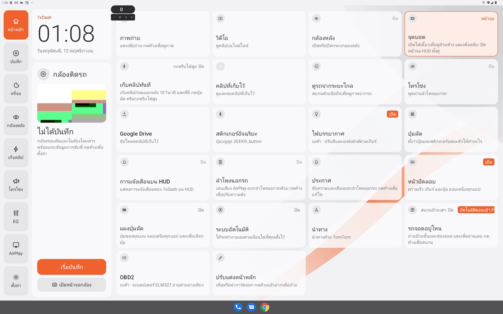
*หน้าหลัก: แถบซ้าย ช่องกล้องติดรถ และการ์ดทุกฟีเจอร์*

**หน้าหลัก**
- แตะการ์ดเพื่อใช้งาน กดค้างที่การ์ดเพื่อไปหน้าตั้งค่าของฟีเจอร์นั้น
- กดค้างแล้วลากเพื่อสลับตำแหน่งการ์ด
- การ์ดสุดท้าย **ปรับหน้าหลัก** ใช้เพิ่มหรือนำการ์ดออก ลากที่จุดหกจุดเพื่อย้าย แตะ × เพื่อนำออก แตะการ์ดในส่วนการ์ดอื่นๆ เพื่อเพิ่มกลับ
- แถบซ้าย (หน้าหลัก, บันทึก, หรี่จอ, กล้องหลัง, เก็บคลิป, โทรโข่ง, EQ, AirPlay, ตั้งค่า) มีอยู่ทุกหน้า

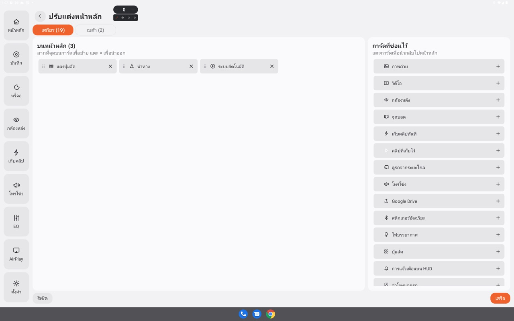
*ปรับหน้าหลัก: การ์ดบนหน้าหลักทางซ้าย การ์ดที่ซ่อนไว้ทางขวา*

**ฟีเจอร์เบต้า** จะซ่อนอยู่จนกว่าจะเปิด ตั้งค่า → อินเทอร์เฟซ → **ฟีเจอร์เบต้า** เมื่อเปิดแล้วหน้าหลักจะแยกการ์ดเป็นแท็บ Stable และ Beta

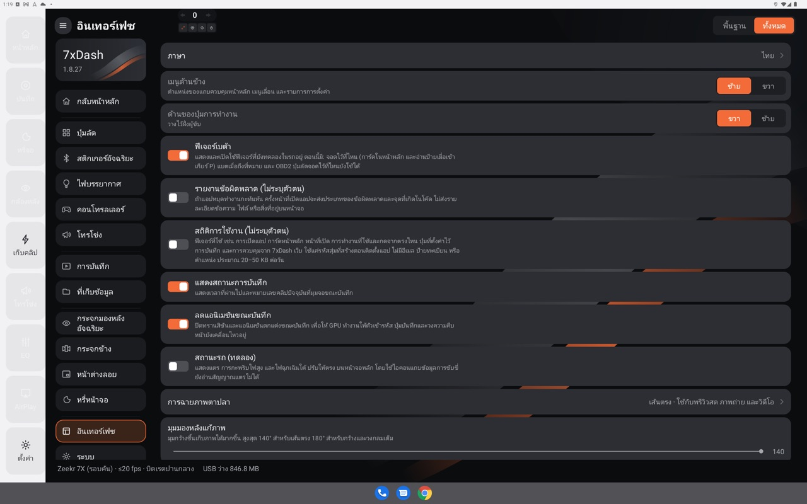
*ตั้งค่า → อินเทอร์เฟซ: ภาษา และสวิตช์ฟีเจอร์เบต้า*

---

## กล้องและการบันทึก

### กล้องติดรถ
อัดภาพกล้องรอบคันทั้ง 4 ตัวรวมเป็นภาพเดียว พร้อมกล้องในห้องโดยสาร และมีแถบข้อมูลการขับขี่ (ความเร็ว เกียร์ เวลา ทะเบียน) ติดในคลิป

**วิธีใช้**
1. เสียบแฟลชไดรฟ์
2. กด **บันทึก** ที่แถบซ้าย หรือปุ่มอัดบนปุ่มลอย ช่องกล้องติดรถในหน้าหลักจะขึ้นเวลาที่อัดอยู่
3. กด **บันทึก** อีกครั้งเพื่อหยุด คลิปจะถูกตัดเป็นไฟล์สั้นๆ ถ้าเกิดอะไรขึ้นก็ไม่หายเยอะ

**ตั้งค่า**
- ตั้งค่า → การบันทึก: คุณภาพ (Stream profile), เริ่มอัดทันทีที่เปิดแอป, ประทับทะเบียนรถ, เวลา, **แถบข้อมูลการขับขี่**
- ตั้งค่า → ที่เก็บข้อมูล: เลือกไดรฟ์ จำกัดพื้นที่วิดีโอ/ภาพ (เต็มแล้วลบคลิปเก่าเอง), ล็อกคลิปเมื่อบีบแตร
- ตั้งค่า → ระบบ: **อัดต่อเมื่อจอดับ**, เริ่มเมื่อเปิดเครื่อง

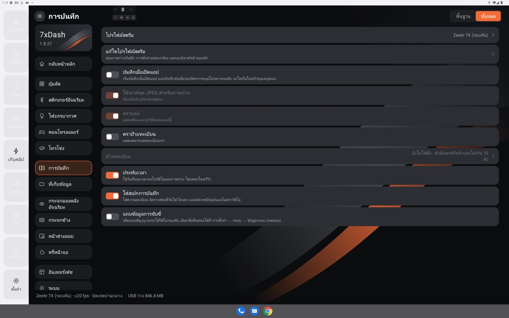
*ตั้งค่า → การบันทึก*

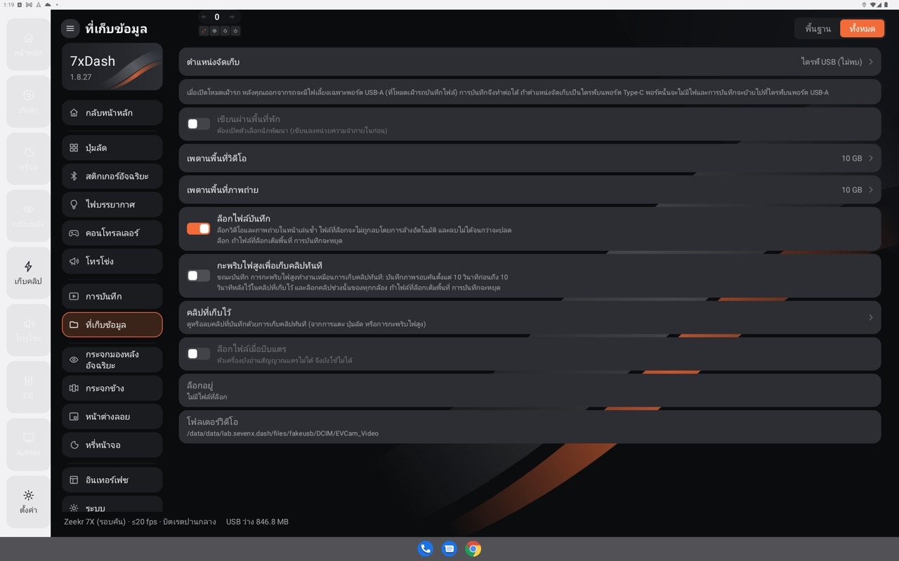
*ตั้งค่า → ที่เก็บข้อมูล*

> แถบข้อมูลการขับขี่เลือกได้ว่าจะแสดงค่าอะไร ใน ตั้งค่า → ระบบ → **ข้อมูลระบบ (ทดลอง)** ติ๊กค่าที่อยากให้อยู่บนแถบ

### ภาพถ่าย
ถ่ายภาพนิ่งจากทุกกล้องในจังหวะเดียวกัน เหมาะกับถ่ายจุดจอด รอยขีดข่วน หรือวิว
- แตะการ์ด **ภาพถ่าย** เพื่อถ่าย กดค้างเพื่อเปิดดูภาพ
- ปุ่มลัดมีแบบ ถ่ายภาพ (ทุกกล้อง), ถ่ายภาพ (รอบคัน), ถ่ายภาพ (ห้องโดยสาร)

### เก็บคลิปทันที
เก็บคลิปช่วง 10 วินาทีก่อนและหลังเหตุการณ์แยกไว้ ไม่ถูกลบตามรอบ
- แตะการ์ด **เก็บคลิปทันที** หรือกดปุ่มลัด
- เปิด **เก็บคลิปด้วยไฟสูง** แล้วกะพริบไฟสูงขณะบันทึก ก็เก็บได้โดยไม่ต้องละมือจากพวงมาลัย
- การ์ด **คลิปที่เก็บไว้** ใช้ดูและลบ ถ้าเชื่อม Google Drive ไว้จะอัปโหลดให้เอง

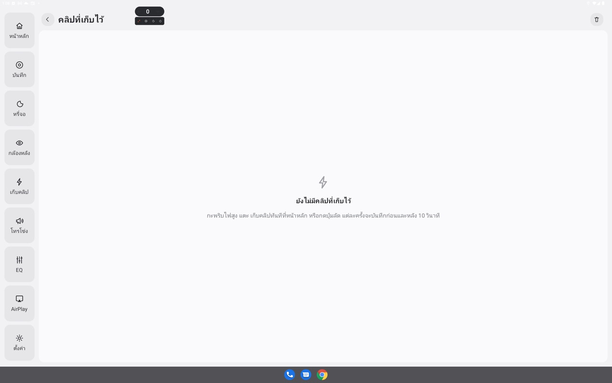
*คลิปที่เก็บไว้ (ยังว่างอยู่)*

### วิดีโอ
แตะการ์ด **วิดีโอ** เพื่อดูคลิปย้อนหลังบนไทม์ไลน์ เลือกกล้อง ซูม และส่งคลิปไปมือถือได้ (สแกน QR ให้มือถืออยู่วง Wi-Fi เดียวกับรถ)

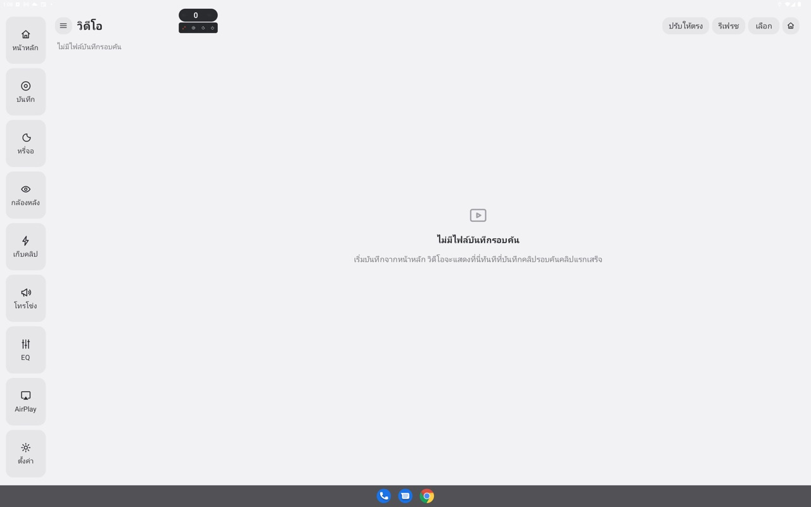
*วิดีโอ: ดูคลิปย้อนหลังบนไทม์ไลน์*

### กระจกมองหลังอัจฉริยะ (Super mirror)
หน้าต่างลอยแสดงกล้องรอบคันตัวใดก็ได้ ภาพกล้องหลังกลับซ้ายขวาเหมือนกระจกมองหลัง
- เปิดจาก **กล้องหลัง** ที่แถบซ้าย การ์ด **กล้องหลัง** หรือปุ่มลัด
- ลากขอบเพื่อย้าย ถ่างนิ้วเพื่อย่อขยาย ดันไปชนขอบจอเพื่อเก็บ (แตะแถบเพื่อเรียกกลับ)
- กลางภาพ: ปัดขึ้นลงเพื่อเลื่อนมุม ปัดซ้ายขวาเพื่อเปลี่ยนกล้อง หรือเปิด **โหมดปุ่ม** แล้วแตะบน ล่าง ซ้าย ขวา เพื่อเลือกกล้องหน้า หลัง ซ้าย ขวา
- ตั้งค่า → Super mirror: แก้ภาพโค้ง (fisheye), มุมมอง, เฉพาะหน้าและหลัง, ขนาดหน้าต่าง
- มีปุ่มลัดแสดงบน HUD ด้วย (**เปิด/ปิดกระจกมองหลังอัจฉริยะบน HUD**)

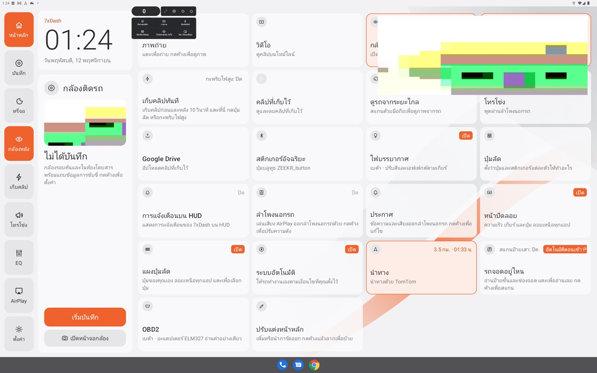
*กระจกมองหลังอัจฉริยะ: หน้าต่างลอยมุมขวาบน (บนอีมูเลเตอร์เป็นภาพทดสอบ)*

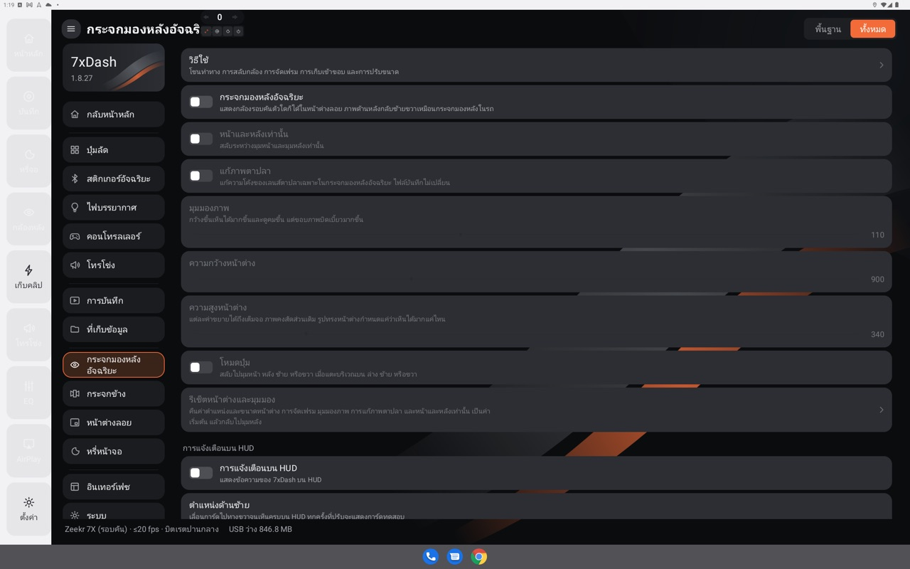
*ตั้งค่า → กระจกมองหลังอัจฉริยะ*

### จุดบอด (ภาพด้านข้างตอนเปิดไฟเลี้ยว)
เปิดไฟเลี้ยวแล้วภาพกล้องด้านนั้นจะเด้งขึ้น และปิดเองเมื่อไฟเลี้ยวดับ
- แตะการ์ด **จุดบอด** เพื่อสลับ: ปิด → หน้าจอ → HUD → ทั้งคู่
- **ขอบสีแดง** บอกด้านที่รถเตือนว่ามีรถในจุดบอด (ไฟเตือนจุดบอด ไฟที่กระจก หรือเตือนรถตัดผ่านด้านหลัง) และกะพริบเมื่อเปิดไฟเลี้ยวไปทางด้านนั้น
- ตั้งค่า → Side mirror: แสดงตั้งแต่ความเร็วเท่าไร, แสดงเมื่อรถเตือน, แสดงเมื่อเปิดประตู, ขนาดและตำแหน่งบนจอ/HUD, ค้างไว้นานเท่าไรหลังไฟเลี้ยวดับ, **Instant pop-up** ตอนเกียร์ D
- ถ้าเปิด **แดงเมื่อมีรถในจุดบอด** (ตั้งค่า → ไฟบรรยากาศ) ไฟบรรยากาศจะกะพริบแดงพร้อมขอบแดง จังหวะเดียวกัน
- ถ้าเปิดแผนที่ลอยอยู่ แผนที่จะลดการวาดลงชั่วคราวตอนภาพด้านข้างขึ้น ให้ภาพกล้องลื่นที่สุด

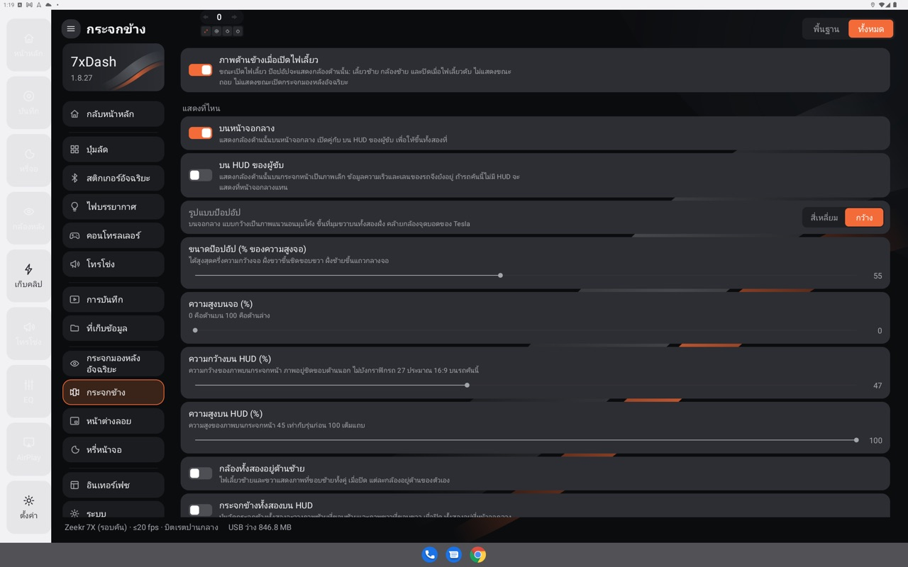
*ตั้งค่า → กระจกข้าง: ที่แสดง เมื่อไรที่แสดง และภาพ*

### ภาพห้องโดยสาร
หน้าต่างลอยแสดงกล้องห้องโดยสารด้านหลัง (ดูเด็กหรือผู้โดยสารด้านหลัง) ย้าย ถ่าง และเก็บข้างจอได้เหมือนกระจกมองหลัง เปิดด้วยปุ่มลัด **เปิด/ปิดภาพห้องโดยสาร** ปรับขนาดใน ตั้งค่า → ระบบ → Cabin passenger

---

## ควบคุมรถ

### ระบบอัตโนมัติ
ให้ 7xDash เปลี่ยนการตั้งค่ารถเองเมื่อเกิดเหตุการณ์ เช่น ฝนตกตอนกลางคืน → เปิดไฟตัดหมอกหลัง
เปิดจากการ์ด **ระบบอัตโนมัติ** ในหน้าหลัก แล้วเปิดสวิตช์ **เปิดใช้ระบบอัตโนมัติ**

รายละเอียดทุกเงื่อนไข ทุกคำสั่ง และตัวอย่างการใช้งานจริง อยู่ใน [คู่มือระบบอัตโนมัติ](automation.md)

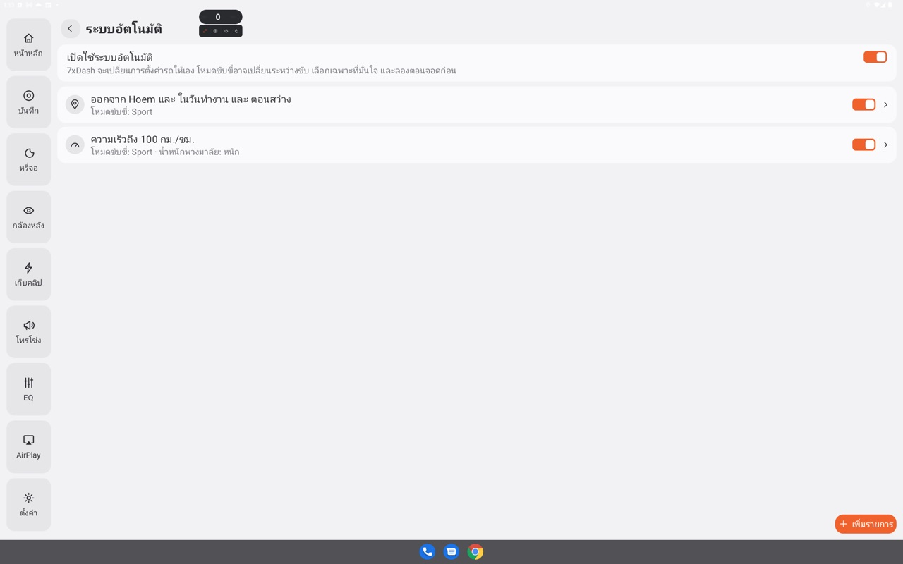
*รายการระบบอัตโนมัติ: สวิตช์หลักด้านบน แต่ละรายการเปิดปิดแยกได้*

### ม่านซันรูฟ
สั่งม่านซันรูฟให้เปิด/ปิดได้โดยไม่ต้องเข้าเมนูรถ
- **ปุ่มลัด**: เปิดม่านซันรูฟ, ปิดม่านซันรูฟ, เปิด/ปิดม่านซันรูฟ (ปุ่มเดียว ถ้าปิดอยู่จะเปิด ถ้าเปิดอยู่จะปิด)
- **ระบบอัตโนมัติ**: คำสั่ง **ม่านซันรูฟ** เลือก ปิด, 25%, 50%, 75% หรือ เปิดสุด
- รถเป็นคนตัดสินว่าจะยอมขยับเมื่อไร ถ้ารถไม่ยอม 7xDash จะแจ้งข้อความ

### น้ำหนักพวงมาลัย
ปรับความหนักของพวงมาลัย (เบา / สมดุล / หนัก) แบบเดียวกับในเมนูโหมดขับขี่ของรถ
- **ปุ่มลัด**: พวงมาลัยเบา, พวงมาลัยสมดุล, พวงมาลัยหนัก และ **น้ำหนักพวงมาลัย: ถัดไป** (กดวน เบา → สมดุล → หนัก → เบา)
- **ระบบอัตโนมัติ**: คำสั่ง **น้ำหนักพวงมาลัย**
- กดแล้วจะมีข้อความบอก เช่น "น้ำหนักพวงมาลัย: หนัก"
- เป็นค่าของโหมด Custom ของรถ ทดสอบแล้วว่าเปลี่ยนได้จริงตอนจอด

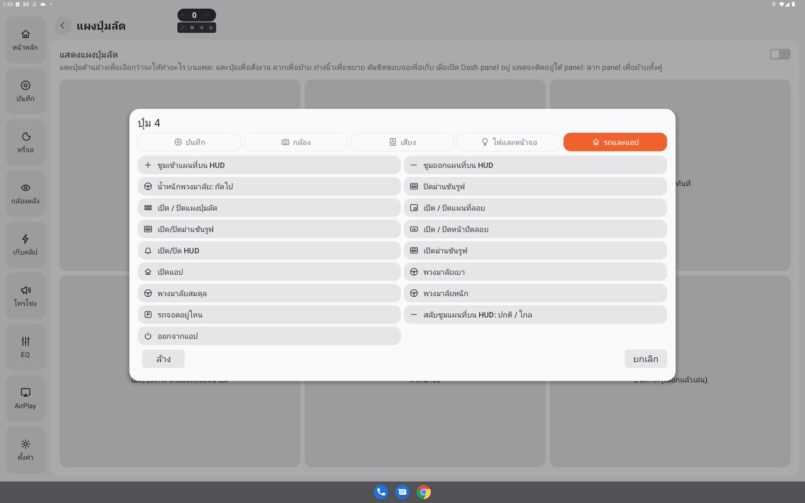
*คำสั่งปุ่มลัดแท็บ รถและแอป: ม่านซันรูฟ น้ำหนักพวงมาลัย แผนที่ลอย ซูมแผนที่บน HUD*

### ไฟตัดหมอกหลัง
เปิด/ปิดไฟตัดหมอกหลังด้วยปุ่มลัด **เปิด/ปิดไฟตัดหมอกหลัง** หรือคำสั่งในระบบอัตโนมัติ (รถต้องเปิดไฟหน้าอยู่)

### ไฟบรรยากาศ (เบต้า)
ควบคุมไฟหลายแหล่งเป็นกลุ่มเดียว ทั้งไฟ RGB บลูทูธราคาถูก (ELK-BLEDOM / Triones) และ **ไฟ Ambient ของรถเอง**
- เปิดจากการ์ด **ไฟบรรยากาศ** หรือ ตั้งค่า → ไฟบรรยากาศ
- ไฟบลูทูธ: ปิดแอปมือถือของไฟก่อน สแกน กด Connect แล้วเลือกสี ความสว่าง เอฟเฟกต์
- **เปลี่ยนสีตามเกียร์**: ตั้งสีและเอฟเฟกต์ให้ P, R, D, D ตอนรถหยุด และสีตามความเร็วในเกียร์ D แยกกลุ่มไฟได้
- **แดงเมื่อมีรถในจุดบอด**: ไฟกะพริบแดงสลับสีเดิมเมื่อรถเตือนจุดบอด จังหวะเดียวกับขอบแดงของภาพด้านข้าง
- ปุ่มลัด **เปิด/ปิดไฟบรรยากาศ** และคำสั่งในระบบอัตโนมัติ (เปิด/ปิด, สี, ไฟ Ambient ของรถ, ความสว่าง)

> ไฟ Ambient ของรถแยกซ้าย-ขวาไม่ได้: ทดสอบในรถแล้ว รถสั่งได้ทีละทั้งคัน

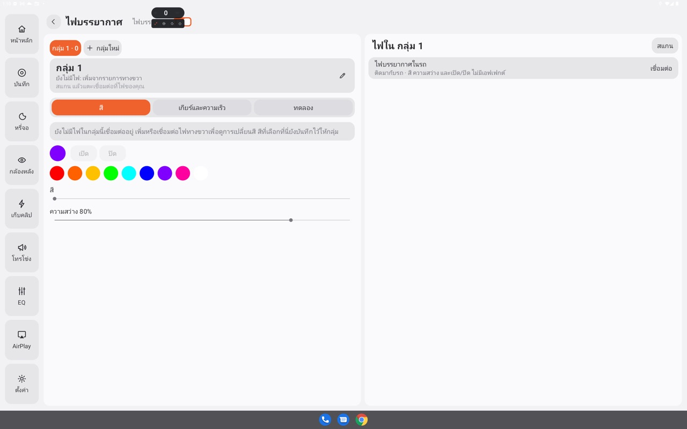
*ไฟบรรยากาศ: กลุ่มไฟ สีตามเกียร์ และสี*

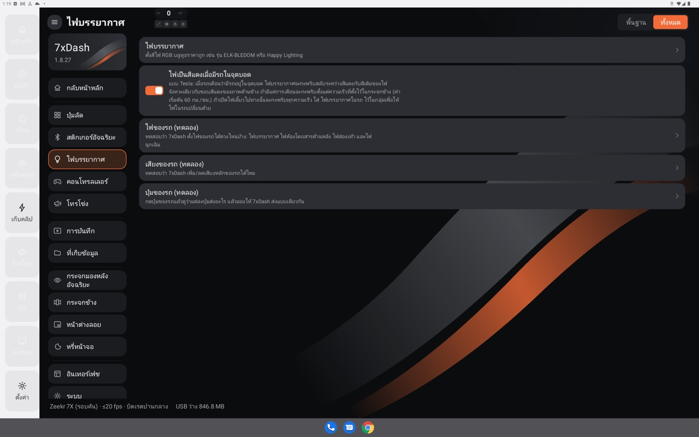
*ตั้งค่า → ไฟบรรยากาศ: แดงเมื่อมีรถในจุดบอด และเครื่องมือทดลอง*

---

## การนำทาง
นำทางทีละจุดด้วย TomTom มีจราจรสด เส้นทางทางเลือก แบตเตอรี่เมื่อถึง ทางเลี้ยวถัดไปบน HUD แผนที่บน HUD และแผนที่ลอยเหนือแอปอื่น
เปิดจากการ์ด **นำทาง** ในหน้าหลัก

วิธีใช้ทุกฟังก์ชันอยู่ใน [คู่มือการนำทาง](navigation.md)

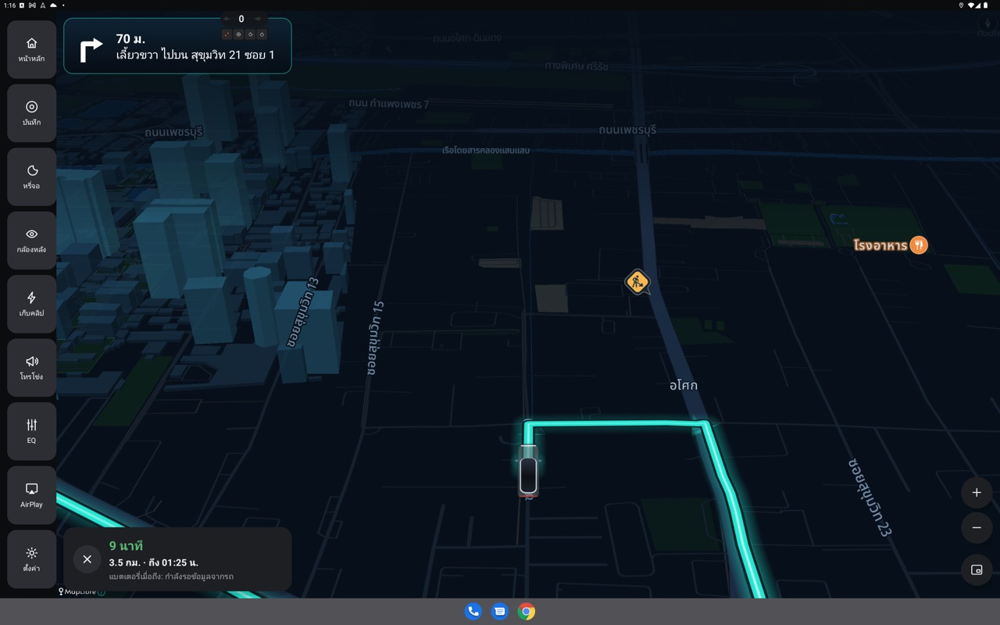
*ขณะนำทาง: ทางเลี้ยวถัดไปด้านบน เวลาและระยะที่เหลือด้านล่าง*

---

## หน้าต่างลอยและปุ่ม

### ปุ่มลอย
ปุ่มเล็กลอยเหนือทุกแอป มีปุ่มอัด (พร้อมเวลาที่อัด) ปุ่มหรี่จอรูปพระจันทร์ และปุ่มออกจากแอป
- ตั้งค่า → Floating button: แตะ/กดค้างให้ทำอะไร ความทึบ ล็อกตำแหน่ง แสดงเวลาอัด
- **ออกจากแอป**: แตะครั้งแรกปุ่มจะเป็นสีแดง แตะซ้ำภายใน 3 วินาทีเพื่อหยุดอัดและปิด 7xDash

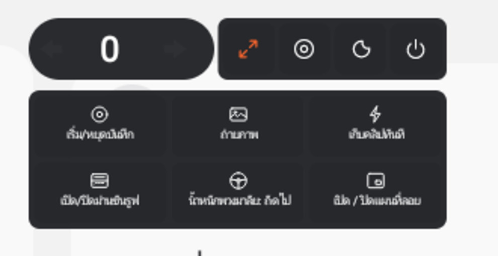
*ซ้ายบน: หน้าปัดลอย (ความเร็ว) ขวาบน: ปุ่มลอย (ขยาย อัด หรี่จอ ออก) ล่าง: แผงปุ่มลัด*

### หน้าปัดลอย
แผงลอยเหนือทุกแอป แสดงความเร็ว เกียร์ และปุ่มที่ใช้บ่อย รวมถึงข้อมูลทริป (ระยะที่เหลือ · แบตเตอรี่เมื่อถึง)
- แตะการ์ด **หน้าปัดลอย** หรือปุ่มลัด **เปิด / ปิดหน้าปัดลอย**
- ตั้งค่า → Floating windows: เปิดใช้ และคืนตำแหน่งเดิม

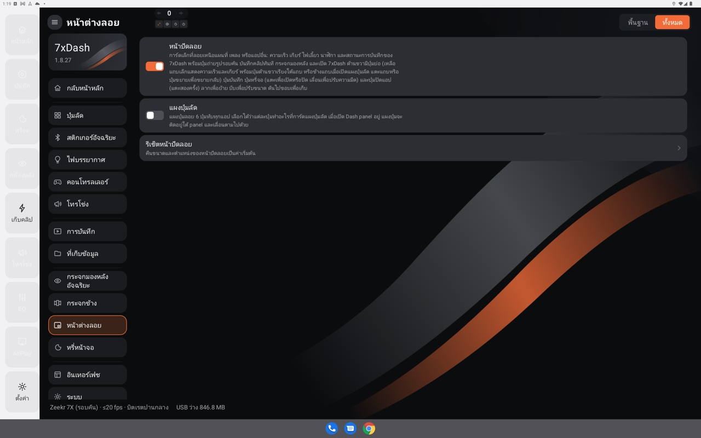
*ตั้งค่า → หน้าต่างลอย*

### แผงปุ่มลัด (Macro pad)
แผงปุ่มของคุณเอง ลอยเหนือทุกแอป ใส่คำสั่งปุ่มลัดอะไรก็ได้ เช่น เปิดม่านซันรูฟ, พวงมาลัยหนัก, แผนที่ลอย
- แตะการ์ด **แผงปุ่มลัด** เพื่อเลือกปุ่ม แล้วเปิดแผงด้วยปุ่มลัด **เปิด / ปิดแผงปุ่มลัด**

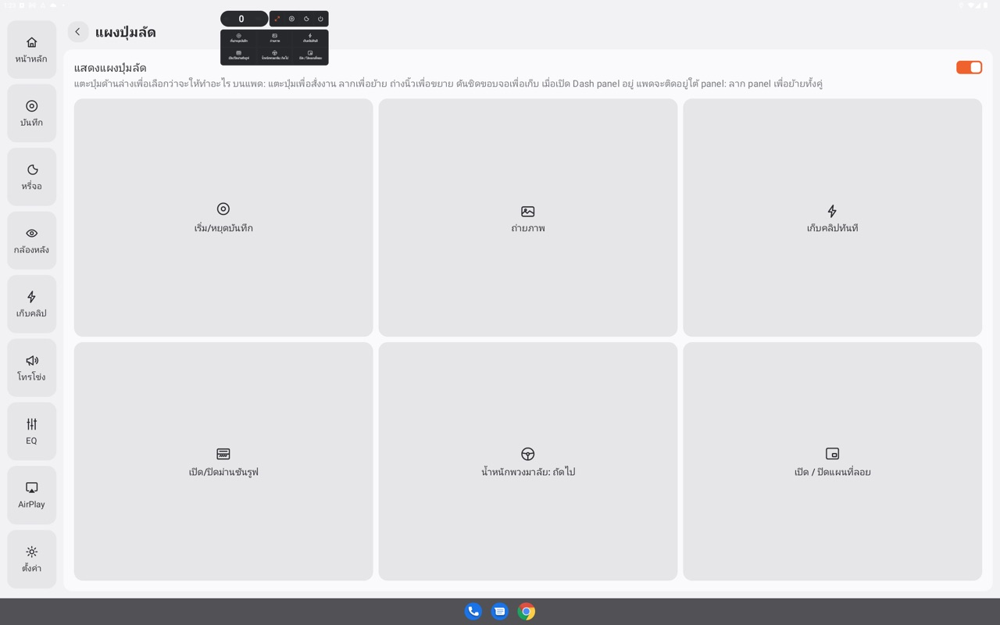
*แผงปุ่มลัด: แตะช่องเพื่อเลือกคำสั่ง สวิตช์ด้านบนเปิดแผงบนจอ*

### หรี่จอ
ม่านโปร่งแสงคลุมทั้งจอ ให้แผนที่ไม่จ้าตอนกลางคืน แตะทะลุไปถึงแอปข้างใต้ได้
- กด **หรี่จอ** ที่แถบซ้าย หรือพระจันทร์บนปุ่มลอย ลากบนพระจันทร์เพื่อปรับมืด/สว่าง
- ตั้งค่า → Dim overlay: ความทึบ ความสว่าง ความอุ่นของสี และ **หรี่ตามเวลาอัตโนมัติ**
- ระบบอัตโนมัติสั่งหรี่ได้ เช่น เริ่มมืด → หรี่จอ 50%

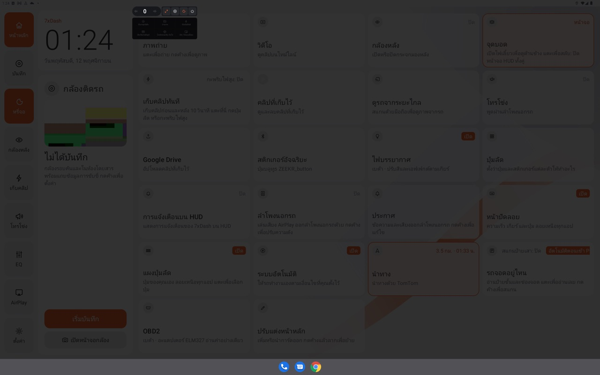
*เปิดหรี่จอ: ทั้งจอมืดลงแต่ยังแตะใช้งานได้*

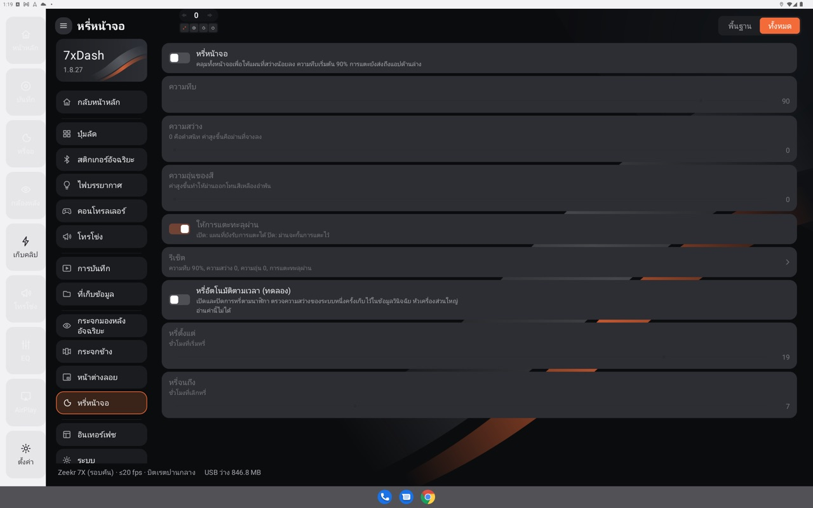
*ตั้งค่า → หรี่หน้าจอ*

---

## ปุ่มลัด สติกเกอร์ และจอยเกม

ให้ปุ่มบนพวงมาลัย ปุ่มสติกเกอร์บลูทูธ (ZEEKR_button) หรือจอยเกม ทำคำสั่งที่เลือก

**ตั้งปุ่ม**
1. การ์ด **ปุ่มลัด** → **เพิ่มปุ่มลัด**
2. กดปุ่มที่ต้องการ
3. เลือกแบบ แตะ, กดค้าง หรือกดสองครั้ง
4. เลือกคำสั่ง แต่ละรายการแก้ไขหรือลบได้ภายหลัง

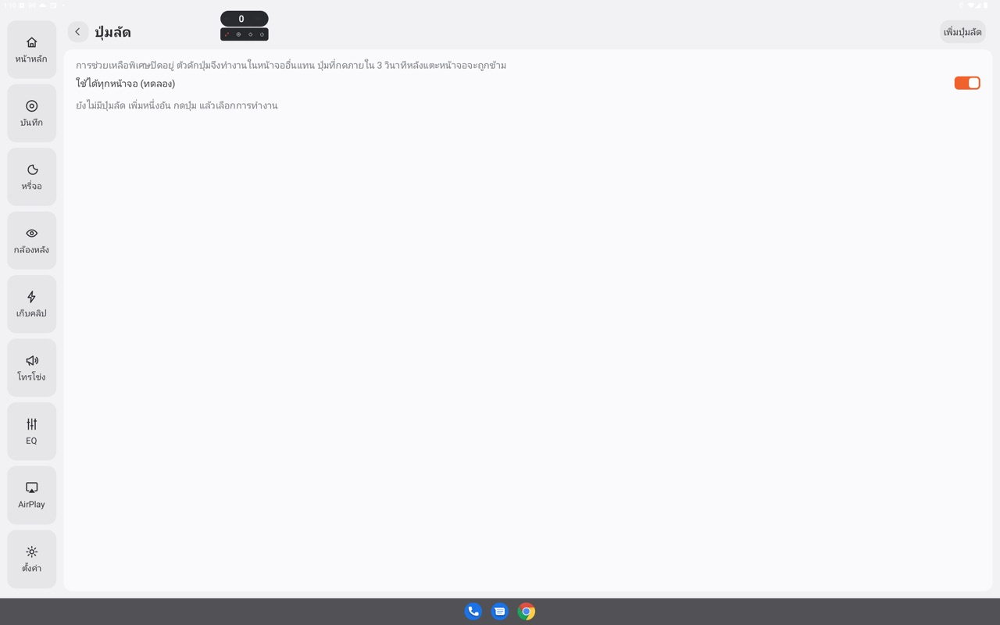
*ปุ่มลัด: รายการปุ่มที่ตั้งไว้ และปุ่มเพิ่มปุ่มลัดมุมขวาบน*

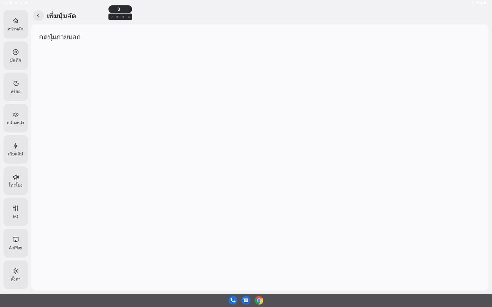
*เพิ่มปุ่มลัด ขั้นแรก: กดปุ่มที่ต้องการ*

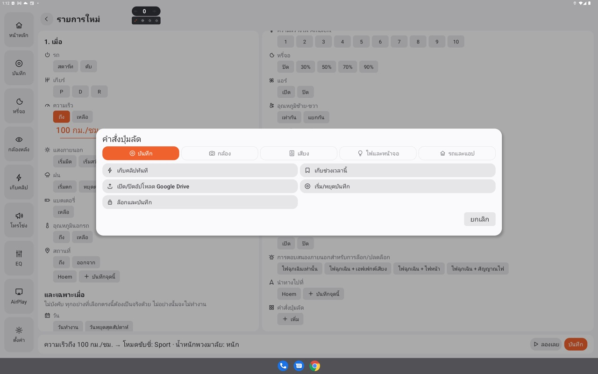
*เลือกคำสั่ง แยกเป็นแท็บ บันทึก กล้อง เสียง ไฟและหน้าจอ รถและแอป*

**สติกเกอร์อัจฉริยะ**: การ์ด **สติกเกอร์อัจฉริยะ** กดสติกเกอร์ค้างจนตื่น สแกน แล้วกดเพื่อผูกคำสั่ง

*สติกเกอร์อัจฉริยะ*

**จอยเกม**: ตั้งค่า → Controller ทำแบบเดียวกัน

**คำสั่งที่เลือกได้** (แยกเป็นแท็บในหน้าเลือก)

| กลุ่ม | คำสั่ง |
|---|---|
| บันทึก | เริ่ม/หยุดบันทึก, เก็บช่วงเวลานี้, ล็อกและบันทึก, เก็บคลิปทันที, เปิด/ปิดอัปโหลด Google Drive |
| กล้อง | กระจกมองหลังอัจฉริยะ (จอ/HUD), กระจกข้างทั้งสองด้าน, ภาพห้องโดยสาร, ถ่ายภาพ (ทุกกล้อง/รอบคัน/ห้องโดยสาร) |
| เสียง | พูดออกนอกรถ (กดค้าง/กดสลับ), ประกาศ, เล่นประกาศ…, AirPlay, EQ, ลำโพงนอกรถ, เพิ่ม/ลดเสียง, เล่น/หยุด, เพลงถัดไป/ก่อนหน้า |
| ไฟ | ไฟบรรยากาศ, หรี่หน้าจอ, ไฟตัดหมอกหลัง |
| รถ | เปิดแอป, เปิด/ปิด HUD, รถจอดอยู่ไหน, หน้าปัดลอย, แผงปุ่มลัด, แผนที่ลอย, ซูมแผนที่บน HUD (เข้า/ออก/สลับ), ม่านซันรูฟ (เปิด/ปิด/สลับ), น้ำหนักพวงมาลัย (เบา/สมดุล/หนัก/ถัดไป), ออกจากแอป |

---

## เสียง

### โทรโข่ง
พูดกับคนนอกรถผ่านลำโพงนอกรถ ใช้ไมโครโฟนในห้องโดยสาร
- แตะการ์ดหรือปุ่ม **โทรโข่ง** ที่แถบซ้าย หรือตั้งปุ่มลัด (กดค้างเพื่อพูด หรือกดหนึ่งครั้งเพื่อเปิด/ปิด)
- ตั้งค่า → Megaphone: ความดัง และ **ลำโพง**: ติ๊กลำโพงที่จะให้เสียงออก

### ลำโพงนอกรถ
เสียงที่ AirPlay มาที่ 7xDash (เพลง, สะท้อนหน้าจอ, คลิป) ออกลำโพงนอกรถด้วย
- แตะการ์ด **ลำโพงนอกรถ** หรือปุ่มลัด กดค้างการ์ดเพื่อปรับความดัง
- CarPlay, Spotify บนจอรถ และวิทยุ ส่งออกนอกรถไม่ได้ (รถไม่ให้แอปอื่นดึงเสียง) ให้เล่นจากมือถือผ่าน AirPlay แทน

### ประกาศ
เล่นข้อความหรือเสียงออกลำโพงนอกรถ
- แตะการ์ด **ประกาศ** (หรือปุ่มลัด) จะมีตัวเลือกลอยขึ้น แตะเพื่อเล่น
- กดค้างการ์ดเพื่อเพิ่ม/ลบข้อความของคุณเอง อัดเสียงตัวเองได้ (ปุ่มไมค์ข้างข้อความ)
- มีเสียงในตัว 8 แบบ: กริ่ง, บี๊บสองครั้ง, ไซเรน, แตร, ติ๊งต่อง, สัญญาณเตือน, เสียงถอยหลัง, เสียงเรียกความสนใจ
- เลือกข้อความที่จะเล่นเมื่อ **Sentry Mode เริ่มเฝ้า** ได้ (ไม่เกินนาทีละครั้ง)
- ข้อความภาษาไทยเล่นได้เฉพาะที่อัดเสียงไว้

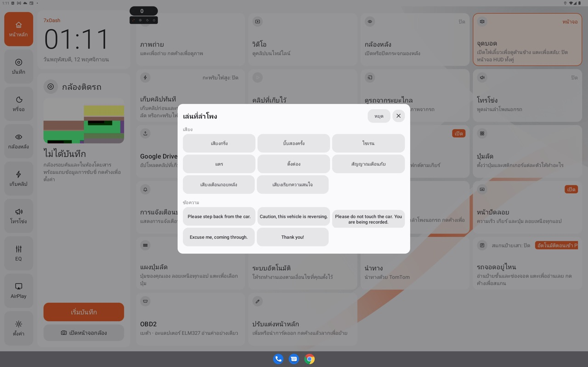
*ตัวเลือกประกาศ: แตะเพื่อเล่น ข้อความของคุณอยู่ด้านล่าง*

### AirPlay
สะท้อนหน้าจอ iPhone หรือส่งวิดีโอจากแอปอย่าง YouTube มาที่จอรถ
1. แตะ **AirPlay** ที่แถบซ้าย
2. บน iPhone เลือก Screen Mirroring → 7xDash
- ภาพขึ้นในหน้าต่างลอย ลากย้าย ถ่างย่อขยาย ดันชิดขอบเพื่อเก็บ แตะสองครั้งเพื่อสลับเล็ก/ใหญ่ × เพื่อหยุด

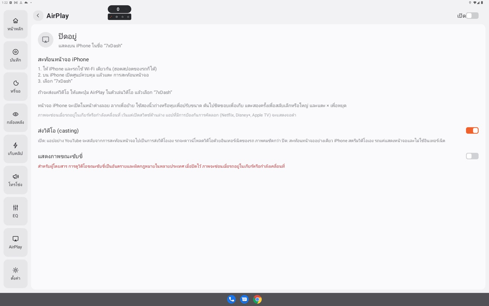
*AirPlay: ขั้นตอนเชื่อม iPhone และตัวเลือก*

### EQ
อีควอไลเซอร์ห้องโดยสาร ทำงานต่อจากเสียงของรถ
- แตะ **EQ** ที่แถบซ้าย ตั้ง EQ ของรถเป็น Flat ก่อน แล้วเปิดเพลงปรับ เลื่อน fader บนพรีเซ็ตแล้วจะบันทึกเป็น My presets

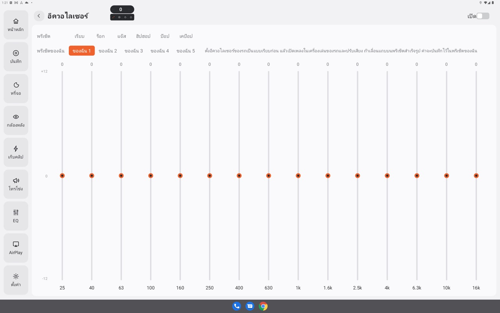
*อีควอไลเซอร์: พรีเซ็ตด้านบน และ fader แต่ละย่านความถี่*

---

## ดูรถจากมือถือ และคลาวด์

### ดูรถจากระยะไกล (7xDash web)
1. แตะการ์ด **ดูรถจากระยะไกล** แล้วสแกน QR ด้วยมือถือ
2. หน้าเว็บมีภาพสดจากแต่ละกล้อง, เปิด/ปิดลำโพงนอกรถ, ความดังลำโพงและโทรโข่ง, เลือกลำโพง, จุดที่จอดรถ และ **ส่งที่หมายไปนำทาง**

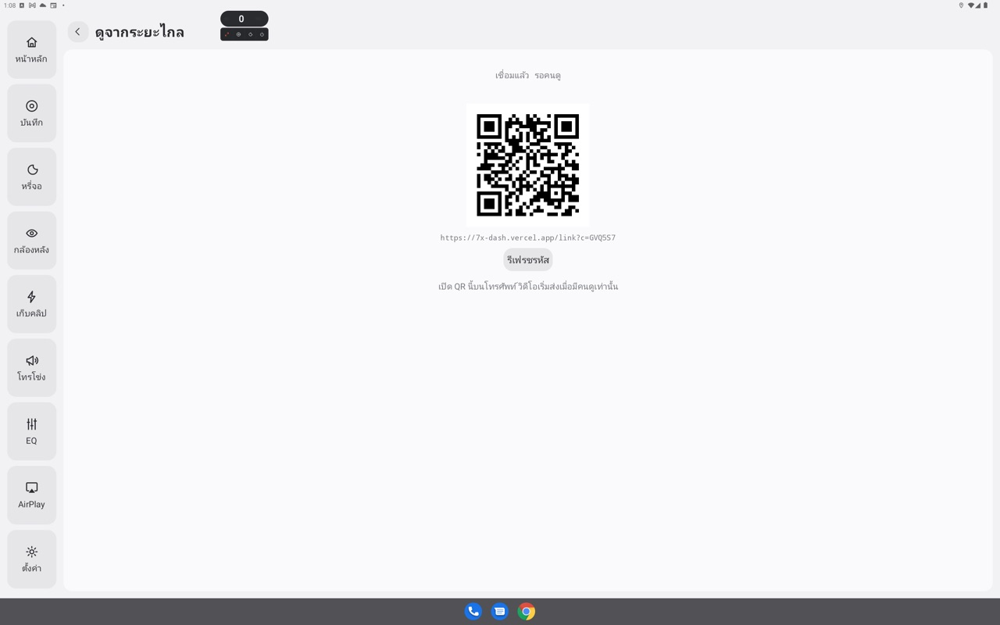
*ดูรถจากระยะไกล: สแกน QR ด้วยมือถือ*

### Google Drive
อัปโหลดคลิปที่เก็บทันทีและคลิปอื่นขึ้น Google Drive แตะการ์ด **Google Drive** แล้วล็อกอินผ่านมือถือ

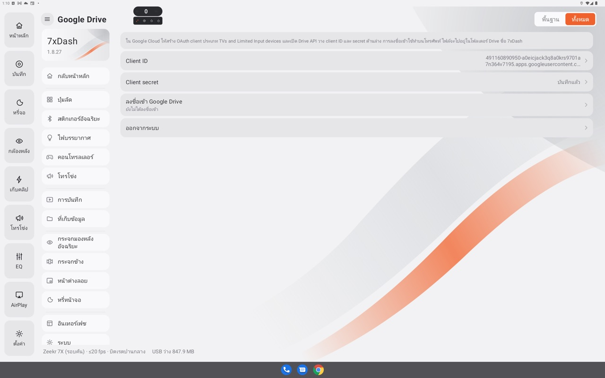
*Google Drive: ล็อกอินและตั้งค่าการอัปโหลด*

### การแจ้งเตือนบน HUD
แสดงข้อความของ 7xDash บน HUD ของคนขับ แตะการ์ดเพื่อเปิด/ปิด ปรับตำแหน่งซ้าย-ขวาใน ตั้งค่า → Super mirror → HUD notifications

---

## ฟีเจอร์เบต้า

ต้องเปิด ตั้งค่า → อินเทอร์เฟซ → **ฟีเจอร์เบต้า** ก่อน

### รถจอดอยู่ไหน
เมื่อเข้าเกียร์ P จะอ่านป้ายชั้นและช่องจอดจากกล้อง (ออฟไลน์) แล้วแสดงพร้อมภาพในแถบแจ้งเตือนและบน 7xDash web
- แตะการ์ดเพื่ออ่านเลย สวิตช์ **Auto on P** อ่านทุกครั้งที่จอด
- สวิตช์ **Pillar scan** อ่านป้ายบนเสาตลอดตอนคลานต่ำกว่า 3 กม./ชม. ในเกียร์ D/R แสดงชั้น/ช่องใหม่บน HUD และเติมข้อมูลให้ตอนเข้า P
- กดค้างการ์ดเพื่อสแกนเอง: เห็นภาพ ชั้น ช่อง และข้อความดิบที่อ่านได้

### OBD2
อ่านค่ารถผ่านอะแดปเตอร์ ELM327 ที่เสียบช่อง OBD (อ่านอย่างเดียว ลบโค้ดหรือแก้อะไรไม่ได้)
1. จับคู่อะแดปเตอร์ Bluetooth Classic ในเมนูบลูทูธของรถ, ต่อ Wi-Fi ของอะแดปเตอร์ หรือกด **Scan for BLE** สำหรับอะแดปเตอร์ BLE
2. แตะการ์ด **OBD2** เลือกอะแดปเตอร์ กด **Connect**
- แสดงแรงดันแบต 12V ค่ามาตรฐาน และค่าจากโมดูลแบตเตอรี่ (แรงดัน กระแส กำลัง อุณหภูมิ SOH เลขไมล์) คำนวณแบบ Volvo EX30 ซึ่งใช้แพลตฟอร์มเดียวกัน ยังไม่ได้ยืนยันกับ 7X ให้เทียบกับจอรถ
- **Scan battery module** และ **Record all signals** เก็บล็อกลง `7xDash/odb_logs` บนแฟลชไดรฟ์
- ถอดอะแดปเตอร์เมื่อเลิกใช้ หลายรุ่นกินไฟแบต 12V

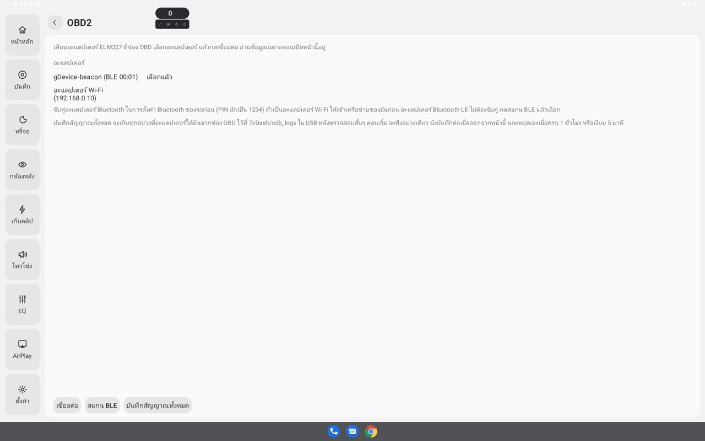
*OBD2: เลือกอะแดปเตอร์ แล้วกด Connect*

---

## เครื่องมือทดลองสำหรับรถ

อยู่ใน ตั้งค่า → ไฟบรรยากาศ ใช้หาว่า 7xDash สั่งอะไรของรถได้บ้าง **ส่งค่าเฉพาะตอนเกียร์ P**

### ไฟของรถ (ทดลอง)
สแกนหาชื่อไฟในระบบรถ (Ambient, ไฟห้องโดยสารหลัง, ไฟเท้า, ไฟฉุกเฉิน) อ่านค่า ลองส่งค่า และกด **Watch** แล้วกดปุ่มไฟในรถ เพื่อดูว่าค่าไหนเปลี่ยน

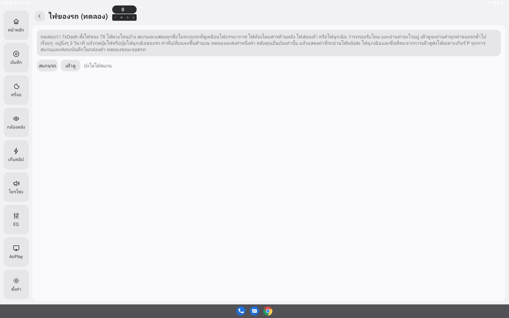
*ไฟของรถ (ทดลอง): สแกนรถ และ เฝ้าดู*

### ปุ่มของรถ (ทดลอง)
1. กด **Listen** แล้วกดปุ่มของรถทีละปุ่ม (พวงมาลัย ปุ่มหมุน ปุ่มบนจอ)
2. แต่ละครั้งจะขึ้นว่าปุ่มส่งอะไร: คีย์ การตั้งค่ารถที่เปลี่ยน หรือบรรทัดในล็อกระบบ
3. การตั้งค่ารถแต่ละรายการมีปุ่ม **คัดลอกชื่อ** ที่ใส่ชื่อลงช่องด้านบนให้

**อ่านหรือส่งค่าการตั้งค่าใดก็ได้ของรถ**
- ช่อง **ชื่อหรือรหัส** (เช่น `0x20080100` หรือชื่อ ECARX), **โซน** (ไม่ใส่ก็ได้), **ค่า**
- **อ่าน**: บอกว่ารถรองรับไหม และตอนนี้อ่านได้ค่าอะไร
- **ส่ง**: ส่งค่าแล้วอ่านกลับ เฉพาะเกียร์ P และต้องกดยืนยัน ทุกครั้งบันทึกลงกล่องดำ
- ใช้ค้นหาฟีเจอร์ใหม่ เช่น ม่านซันรูฟและน้ำหนักพวงมาลัยถูกค้นพบด้วยวิธีนี้

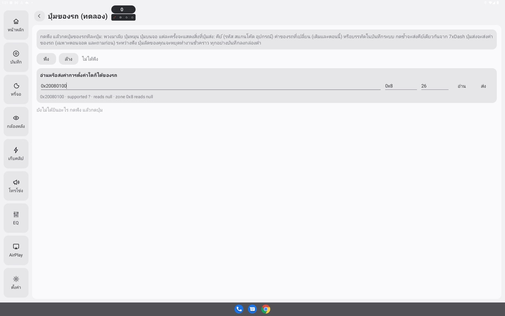
*ปุ่มของรถ (ทดลอง): อ่านค่าม่านซันรูฟ 0x20080100 โซน 0x8 (อีมูเลเตอร์ไม่มีรถ จึงอ่านได้ null)*

### ข้อมูลระบบ (ทดลอง)
ตั้งค่า → ระบบ → **ข้อมูลระบบ (ทดลอง)** แสดงสัญญาณของรถที่อ่านได้ (เกียร์ ความเร็ว ประตู ไฟ เข็มขัด ม่านซันรูฟ ระบบช่วยขับ ฯลฯ) พร้อมค่าปัจจุบัน ติ๊กรายการที่อยากให้ขึ้นบนแถบข้อมูลการขับขี่

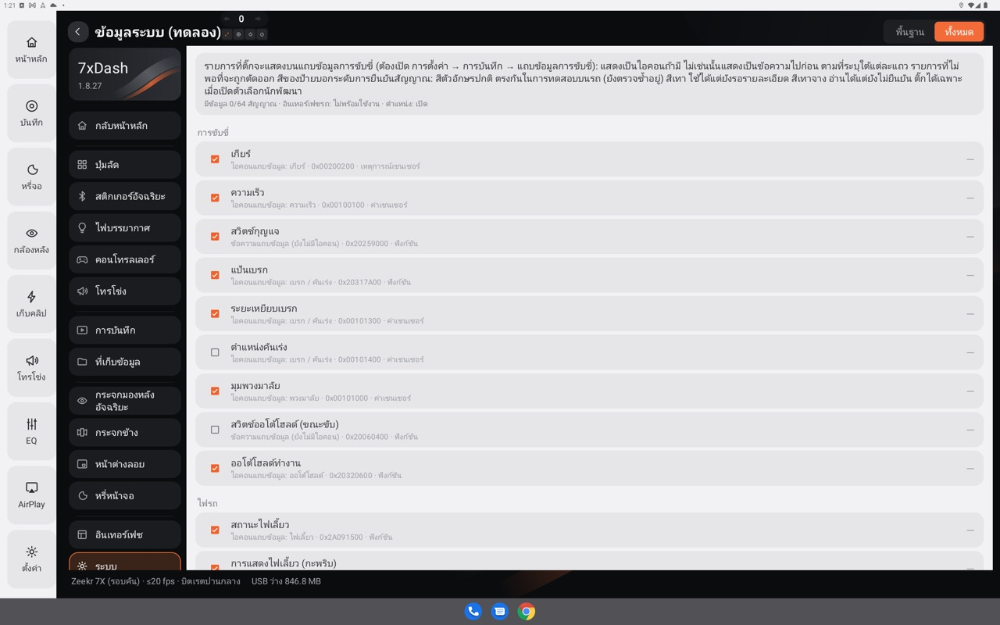
*ข้อมูลระบบ: สัญญาณของรถแยกตามหมวด ติ๊กเพื่อแสดงบนแถบข้อมูลการขับขี่*

---

## ระบบ

### สำรองการตั้งค่าลง USB
การตั้งค่าทั้งหมด (สวิตช์ ปุ่มลัด สติกเกอร์ ไฟ ลำโพง EQ ประกาศ ระบบอัตโนมัติ สถานที่) ถูกคัดลอกไป `7xDash/settings/` บนแฟลชไดรฟ์ไม่กี่วินาทีหลังเปลี่ยน และกลับมาเองหลังติดตั้งใหม่หรือล้างข้อมูล
- ตั้งค่า → ระบบ → **Back up settings to USB** / **Restore settings from USB**
- สิทธิ์ของ Android และการจับคู่บลูทูธไม่อยู่ในไฟล์สำรอง

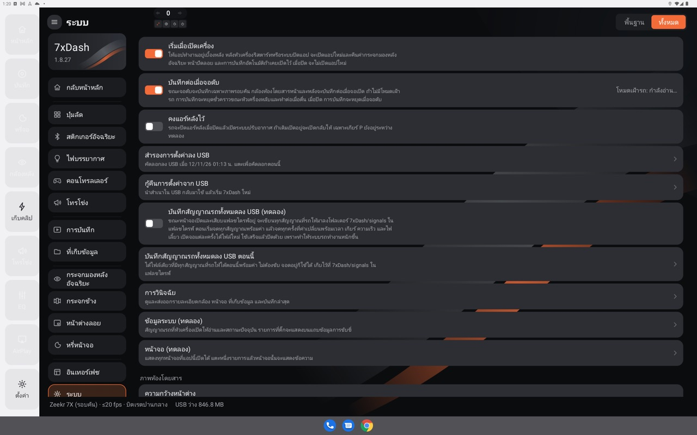
*ตั้งค่า → ระบบ: สำรอง/กู้คืน วินิจฉัยปัญหา ข้อมูลระบบ*

### อัปเดต
ตั้งค่า → Check for updates: ตรวจเวอร์ชันใหม่, ดู What's new, เลือก **Include beta releases** ถ้าอยากได้เวอร์ชันเบต้า

### วินิจฉัยปัญหา
ถ้ามีปัญหา ลองปิดเปิดแอปก่อน ถ้ายังเป็นอยู่ ส่งออกรายงานจาก ตั้งค่า → ระบบ → **Diagnostics** แล้วแนบใน issue
