# การนำทาง (Navigation) แบบเจาะลึก

นำทางทีละจุดบนจอรถ ใช้เส้นทางและจราจรสดจาก TomTom
แสดงทางเลี้ยวถัดไปและแผนที่บน HUD เปิดเป็นแผนที่ลอยเหนือแอปอื่นได้ และบอกแบตเตอรี่ที่จะเหลือเมื่อถึง

[← กลับไปคู่มือฟีเจอร์ทั้งหมด](features.md)

---

## สารบัญ

- [สิ่งที่ต้องมี](#สิ่งที่ต้องมี)
- [หน้าจอนำทาง](#หน้าจอนำทาง)
- [เลือกที่หมาย](#เลือกที่หมาย): ค้นหา, แตะค้างบนแผนที่, สถานที่ที่บันทึกไว้, ส่งจาก iPhone, ส่งจาก 7xDash web
- [ดูเส้นทางก่อนออก](#ดูเส้นทางก่อนออก): เวลา ระยะ เวลาถึง แบตเมื่อถึง เส้นทางทางเลือก
- [ขณะนำทาง](#ขณะนำทาง)
- [แบตเตอรี่เมื่อถึง](#แบตเตอรี่เมื่อถึง)
- [แผนที่ลอย](#แผนที่ลอย)
- [HUD](#hud): การ์ดทางเลี้ยว, แผนที่บน HUD, จัดตำแหน่ง, ซูม
- [ตั้งค่าการนำทาง](#ตั้งค่าการนำทาง)
- [ใช้กับปุ่มลัดและระบบอัตโนมัติ](#ใช้กับปุ่มลัดและระบบอัตโนมัติ)
- [ตั้งค่า iPhone ให้ส่งที่หมายมาที่รถ](#ตั้งค่า-iphone-ให้ส่งที่หมายมาที่รถ)
- [แก้ปัญหา](#แก้ปัญหา)

---

## สิ่งที่ต้องมี

- **อินเทอร์เน็ต** สำหรับค้นหา หาเส้นทาง และจราจร (ระหว่างนำทางใช้เน็ตเฉพาะตอนหาเส้นทางใหม่)
- **GPS ของรถ** 7xDash ใช้ตำแหน่งจากรถ ถ้ายังไม่มีจะขึ้น "กำลังรอ GPS จากรถ…"
- **คีย์ TomTom** ฝังมาในบิลด์ที่ปล่อยบน GitHub แล้ว ถ้าบิลด์เองต้องใส่ `TOMTOM_API_KEY`
- สิทธิ์ **แสดงทับแอปอื่น** สำหรับแผนที่ลอยและ HUD

---

## หน้าจอนำทาง

แตะการ์ด **นำทาง** ในหน้าหลัก

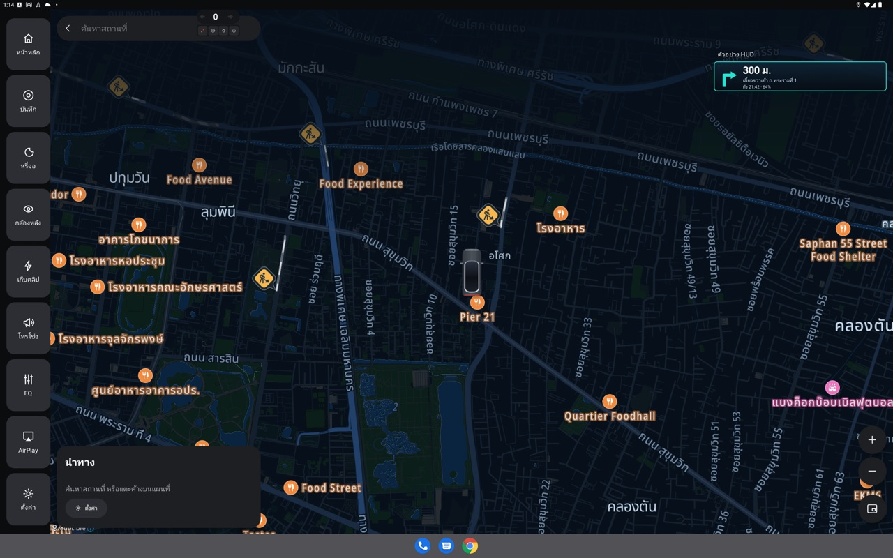
*หน้านำทาง: ช่องค้นหาและสถานที่ที่บันทึกไว้ทางซ้ายบน ตัวอย่าง HUD ทางขวาบน*


| ส่วน | ตำแหน่ง | ทำอะไร |
|---|---|---|
| ช่อง **ค้นหาสถานที่** | บนซ้าย | พิมพ์ชื่อสถานที่ แตะช่องว่างๆ เพื่อดูที่หมายจาก iPhone และสถานที่ที่บันทึกไว้ |
| แผนที่ | เต็มจอ | ลาก ถ่าง หมุนได้ แตะค้างเพื่อปักหมุดที่หมาย |
| การ์ดด้านล่างซ้าย | ล่างซ้าย | ชื่อที่หมาย, เวลา · ระยะ · เวลาถึง, แบตเมื่อถึง, เส้นทางทางเลือก, ปุ่ม **เริ่ม** / **ยกเลิก** / **ตั้งค่า** / **บันทึกสถานที่** |
| แถบทางเลี้ยว | บน (ขณะนำทาง) | ลูกศร ระยะถึงทางเลี้ยวถัดไป และคำแนะนำ |
| **ตัวอย่าง HUD** | บนขวา | หน้าตาการ์ดที่จะขึ้นบน HUD (ปิดได้ในตั้งค่า) |
| ปุ่ม + / − | ล่างขวา | ซูมแผนที่ |
| ปุ่ม **หน้าต่างลอย** | ล่างขวาสุด | ย้ายแผนที่ไปเป็นหน้าต่างลอย แล้วหน้านี้ปิด |

---

## เลือกที่หมาย

### 1. ค้นหา
พิมพ์ในช่อง **ค้นหาสถานที่** ผลจาก TomTom ขึ้นมาไม่เกิน 6 รายการ พร้อมที่อยู่ แตะเพื่อดูเส้นทาง
ค้นหาในประเทศไทย ให้น้ำหนักกับที่ใกล้ตำแหน่งรถ ใช้ได้ทั้งภาษาไทยและอังกฤษ

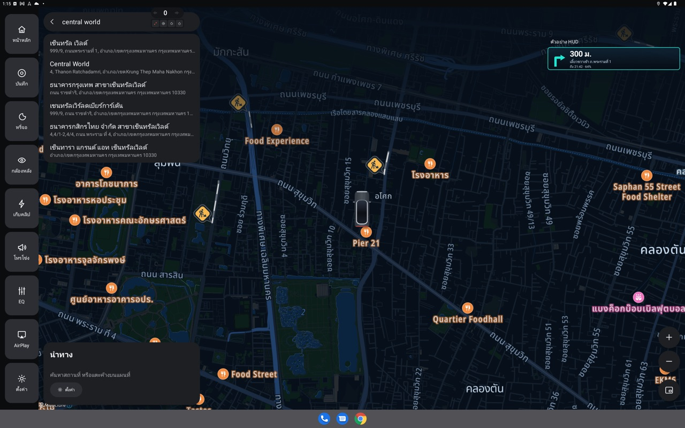
*ผลค้นหา "central world"*


### 2. แตะค้างบนแผนที่
แตะค้างจุดไหนก็ได้บนแผนที่ จะได้ **หมุดที่ปักไว้** และเส้นทางไปจุดนั้นทันที เหมาะกับที่ที่ไม่มีชื่อ เช่น ประตูหลังหมู่บ้าน

### 3. สถานที่ที่บันทึกไว้
แตะช่องค้นหาตอนยังไม่พิมพ์ รายการสถานที่ที่บันทึกไว้จะขึ้น (บ้าน ที่ทำงาน…)
บันทึกที่หมายปัจจุบันด้วยปุ่ม **บันทึกสถานที่** ในการ์ดด้านล่าง สถานที่ชุดเดียวกันใช้ใน[ระบบอัตโนมัติ](automation.md#สถานที่-บ้าน-ที่ทำงาน)

### 4. ส่งจาก iPhone
เปิด Google Maps หรือ Apple Maps บน iPhone เลือกที่หมาย → แชร์ → **Send to 7xDash**
- ถ้าจอนำทางเปิดอยู่: ขึ้นเส้นทางทันที ("ได้รับที่หมายจากโทรศัพท์: … · กำลังแสดงเส้นทาง")
- ถ้ากำลังนำทางอยู่: เปลี่ยนไปที่หมายใหม่ ("ที่หมายใหม่จากโทรศัพท์: … · เปลี่ยนไปที่นี่")
- ถ้าจอปิดอยู่: ที่หมายจะรออยู่บนสุดของรายการ "ไปที่ … · ส่งมาจาก iPhone"

ต้องเปิด **นำทางไปที่ที่แชร์จาก iPhone** และตั้งค่าคำสั่งลัดครั้งแรก ดู [ตั้งค่า iPhone](#ตั้งค่า-iphone-ให้ส่งที่หมายมาที่รถ)

### 5. ส่งจาก 7xDash web
บนหน้าเว็บ **ดูรถจากระยะไกล** (สแกน QR จากการ์ด) วางลิงก์ Google Maps / Apple Maps พิกัด หรือพิมพ์ชื่อสถานที่ แล้วส่ง ใช้ได้กับผู้โดยสารที่ไม่มี iPhone

---

## ดูเส้นทางก่อนออก

เมื่อเลือกที่หมาย การ์ดด้านล่างจะแสดง:

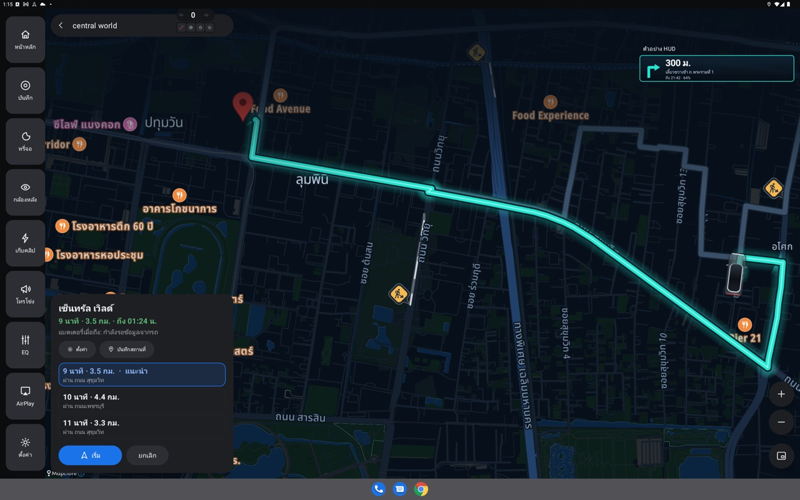
*ดูเส้นทาง: 3 เส้นทางให้เลือก เส้น แนะนำ ถูกเลือกไว้ กด เริ่ม เพื่อออก*


```
หมุดที่ปักไว้
9 นาที · 3.7 กม. · ถึง 12:41
แบตเตอรี่เหลือ 64% เมื่อถึง

 9 นาที · 3.7 กม. · แนะนำ     ผ่าน ถนนสุขุมวิท     ← เลือกอยู่
13 นาที · 6.6 กม.              ผ่าน ถนนเพชรบุรี
 9 นาที · 3.6 กม.              ผ่าน ถนนสุขุมวิท
```

- **เส้นทางทางเลือก**: TomTom ให้สูงสุด 3 เส้น เส้นที่ขึ้นว่า **แนะนำ** คือเส้นที่ดีที่สุดตามจราจรตอนนั้น แตะการ์ดหรือเส้นสีเทาบนแผนที่เพื่อเลือกเส้นอื่น
- เวลาคำนวณรวม **จราจรสด**
- กด **เริ่ม** เพื่อนำทาง หรือ **ยกเลิก**
- ถ้าหาเส้นทางไม่ได้ จะมีปุ่ม **ลองอีกครั้ง**

---

## ขณะนำทาง

**แถบทางเลี้ยว** (บนจอ) แสดงลูกศร ระยะถึงทางเลี้ยวถัดไป ("300 ม.") และคำแนะนำ ("เลี้ยวขวาเข้า ถ.พระรามที่ 1")
บรรทัดที่สองเป็นข้อมูลเพิ่มจาก TomTom เช่น "ทางด่วน" หรือ "ที่หมายอยู่ทางซ้าย"

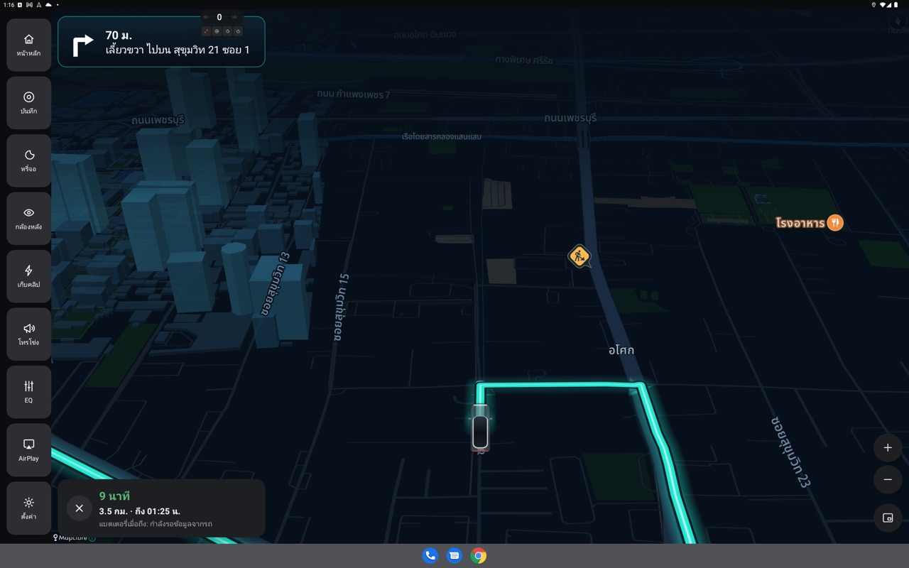
*ขณะนำทาง: แผนที่ 3 มิติตามรถ การ์ดล่างซ้ายแสดงเวลา ระยะ เวลาถึง และแบตเมื่อถึง × คือ สิ้นสุด*


**แผนที่ตามรถ** แบบ 3 มิติ หันตามทิศรถ
- ลากแผนที่ด้วยมือได้ ปุ่ม **กลับไปที่รถ** จะพากลับมาตามรถ
- ปุ่ม + / − ขณะนำทางจะจำระดับซูมไว้ใช้ทริปหน้า

**ออกนอกเส้นทาง**
- ถ้ารถห่างเส้นทางเกิน 45 ม. ติดกัน 3 ครั้ง จะขึ้น "กำลังหาเส้นทางใหม่…" แล้วหาเส้นทางจากจุดที่อยู่
- หาเส้นทางใหม่ไม่ถี่กว่า 10 วินาทีครั้ง (GPS ในลานจอดมักแกว่ง)

**จราจร**: ทุก 10 นาที 7xDash ขอเส้นทางใหม่จาก TomTom เพื่ออัปเดตจราจรและเวลาถึง

**ปิดหน้าจอนำทางได้** การนำทางยังทำงานต่อ บน HUD แผนที่ลอย และหน้าปัดลอย
แถบแจ้งเตือนจะขึ้น "กำลังนำทาง: อัปเดตตำแหน่งของคุณอยู่" จนกว่าจะถึงหรือกด **สิ้นสุด**

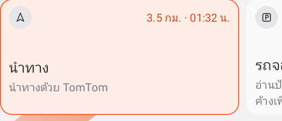
*การ์ด นำทาง ในหน้าหลักขณะนำทาง: ระยะที่เหลือ · เวลาถึง*


**ถึงที่หมาย**: เมื่อรถเข้าใกล้ไม่เกิน 30 ม. จะขึ้น **ถึงแล้ว** ค้างไว้ 15 วินาที แล้วจบการนำทางเอง

> ตอนนี้ยังไม่มีเสียงบอกทาง: ระบบเสียงของจอรถทำให้การนำทางค้าง จึงปิดไว้ ใช้การ์ดบน HUD แทน

---

## แบตเตอรี่เมื่อถึง

คำนวณจากแบตเตอรี่และระยะวิ่งที่เหลือที่รถรายงาน เทียบกับระยะทางที่เหลือ

| แสดง | ความหมาย | สี |
|---|---|---|
| แบตเตอรี่เหลือ 64% เมื่อถึง | พอ | ปกติ |
| แบตเตอรี่เหลือ 12% เมื่อถึง | เหลือน้อยกว่า 15% | ส้ม |
| ขาดอีก 40 กม.: แวะชาร์จระหว่างทาง | ไปไม่ถึง | แดง |
| แบตเตอรี่เมื่อถึง: กำลังรอข้อมูลจากรถ | รถยังไม่ส่งค่ามา | ปกติ |

แสดงทั้งในการ์ดเส้นทาง บน HUD ("ถึง 14:35 · 64%") ชิปบนแผนที่ลอย และหน้าปัดลอย
ค่าอัปเดตไปตลอดทาง

---

## แผนที่ลอย

แผนที่นำทางในหน้าต่างลอยเหนือแอปอื่น ใช้จอเต็มกับเพลง CarPlay หรือแอปอื่นได้ขณะนำทาง

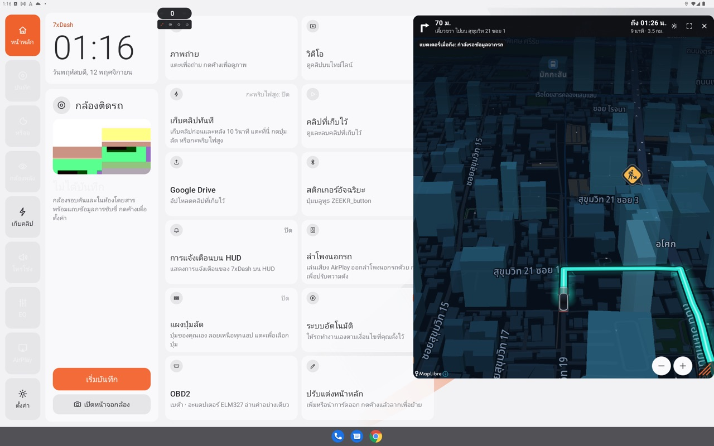
*แผนที่ลอยทางขวา ใช้หน้าหลักหรือแอปอื่นทางซ้ายได้ต่อ*


**เปิด**
- ปุ่ม **หน้าต่างลอย** ล่างขวาของหน้านำทาง หรือ
- ปุ่มลัด **เปิด / ปิดแผนที่ลอย** (ตั้งบนพวงมาลัย แผงปุ่มลัด หรือในระบบอัตโนมัติ)
- ครั้งแรกต้องอนุญาต "แสดงทับแอปอื่น"

**สิ่งที่อยู่บนหน้าต่าง**

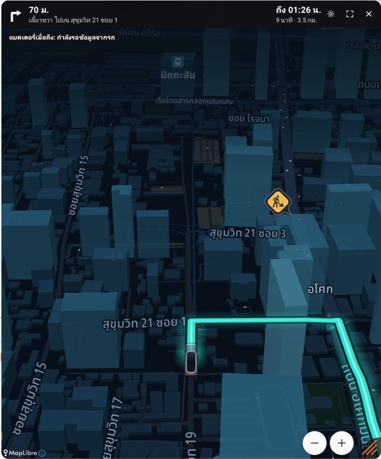
*แผนที่ลอยแบบใกล้: ทางเลี้ยวซ้ายบน "ถึง 01:25 น." และ "9 นาที · 3.5 กม." ขวาบน*


```
[↰] 250 ม.                      ถึง 12:41   ⚙  ⛶  ✕
    ชิดซ้ายตามถนน                 9 นาที · 3.7 กม.
[แบตเตอรี่เหลือ 64% เมื่อถึง]
              (แผนที่)
                                        [−] [+]  ⟋
```

| ส่วน | ทำอะไร |
|---|---|
| ซ้ายบน | ลูกศร ระยะถึงทางเลี้ยวถัดไป และคำแนะนำ (ก่อนเริ่มแสดงชื่อที่หมายและสรุปเส้นทาง) |
| **ถึง 12:41** | เวลาที่จะถึง (ขณะนำทาง) |
| **9 นาที · 3.7 กม.** | เวลาและระยะทางที่เหลือ |
| ชิปแบต | แบตเตอรี่เมื่อถึง สีตามระดับ |
| ⚙ | แผงตั้งค่าการนำทาง เปิดข้างหน้าต่าง |
| ⛶ | กลับไปหน้านำทางเต็มจอ |
| ✕ | ปิดหน้าต่างลอย (การนำทางยังทำต่อบน HUD) |
| ปุ่ม **เริ่ม** / **ลองอีกครั้ง** | ขึ้นบนแถบตอนดูเส้นทางหรือหาเส้นทางไม่ได้ |
| − / + | ซูม ขณะนำทางจะจำไว้ |
| **กลับไปที่รถ** | ขึ้นเมื่อเลื่อนแผนที่ออกจากรถ |
| มุมขวาล่าง ⟋ | ลากเพื่อปรับความกว้างและความสูง |

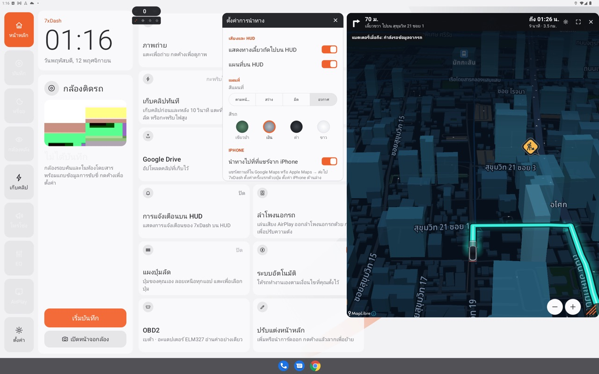
*กด ⚙ บนแผนที่ลอย แผงตั้งค่าเปิดข้างหน้าต่าง*

**การจัดหน้าต่าง**
- **ลากแถบด้านบน** เพื่อย้าย ดันไปชนขอบจอเพื่อเก็บข้างจอ
- **แตะแถบสองครั้ง** สลับขนาดเล็ก (ประมาณ 1/3 จอ) กับใหญ่ (ประมาณ 60% ของจอ)
- ตำแหน่งและขนาดจำไว้ใช้ครั้งหน้า
- เปิดได้ทีละแผนที่: เปิดหน้านำทางเต็มจอแล้วแผนที่ลอยจะปิด

**ไม่แย่งกล้องจุดบอด**: เมื่อภาพกล้องด้านข้างเด้งขึ้นตอนเปิดไฟเลี้ยว แผนที่ลอยจะลดการวาดเหลือ 12 เฟรม/วินาทีชั่วคราว ให้ภาพกล้องลื่น แล้วกลับเป็นปกติเมื่อภาพด้านข้างปิด

---

## HUD

### การ์ดทางเลี้ยวบน HUD
เปิด **แสดงทางเลี้ยวถัดไปบน HUD** (ตั้งค่า → เสียงและ HUD) การ์ดบน HUD แสดง:
- ลูกศรทางเลี้ยว และระยะ ("300 ม.")
- คำแนะนำ ("เลี้ยวขวาเข้า ถ.พระรามที่ 1") หรือ "กำลังหาเส้นทางใหม่…"
- ทริป: "ถึง 21:42 · 64%" สีส้มเมื่อแบตเหลือน้อย แดงเมื่อไปไม่ถึง
- เมื่อถึง: "ถึงแล้ว" พร้อมชื่อที่หมาย

### แผนที่บน HUD
เปิด **แผนที่บน HUD** เพื่อให้แผนที่เล็กขึ้นข้างการ์ดบน HUD ด้วย
- ซูมด้วยปุ่มลัด **ซูมเข้า/ซูมออกแผนที่บน HUD** หรือ **สลับซูมแผนที่บน HUD: ปกติ / ไกล** (ปุ่มเดียว ไว้มองไกลตอนขึ้นทางด่วน) ระดับซูมจำไว้ทริปหน้า

### จัดตำแหน่งบน HUD
ตั้งค่าการนำทาง → **จัดตำแหน่งบน HUD** (จากหน้านำทางเต็มจอ)
- จะเห็นรูป HUD ย่อพร้อมการ์ดและแผนที่ ลากเพื่อย้าย ลากมุมสีส้มเพื่อปรับขนาด HUD จริงจะขยับตามทันที
- **คืนค่าเดิม** เพื่อกลับตำแหน่งเริ่มต้น **เสร็จ** เพื่อบันทึก

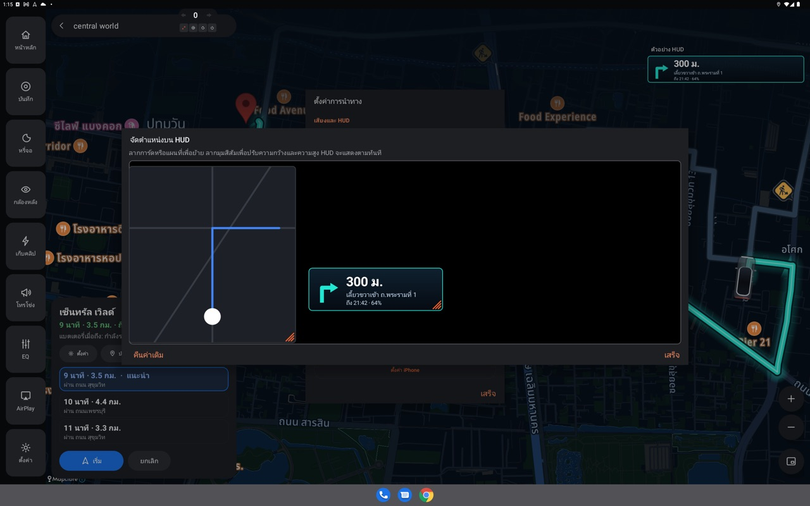
*จัดตำแหน่งบน HUD: แผนที่ทางซ้าย การ์ดทางเลี้ยวทางขวา ลากมุมสีส้มเพื่อปรับขนาด*


### ตัวอย่าง HUD บนแผนที่
**แสดงการ์ด HUD บนแผนที่** แสดงการ์ดตัวอย่างมุมขวาบนของหน้านำทาง ให้เห็นว่าบน HUD จะหน้าตาแบบไหน (ซ่อนเองระหว่างนำทาง เพราะแถบทางเลี้ยวแสดงอยู่แล้ว)

---

## ตั้งค่าการนำทาง

เปิดจากปุ่ม **ตั้งค่า** ในการ์ดหน้านำทาง หรือ ⚙ บนแผนที่ลอย

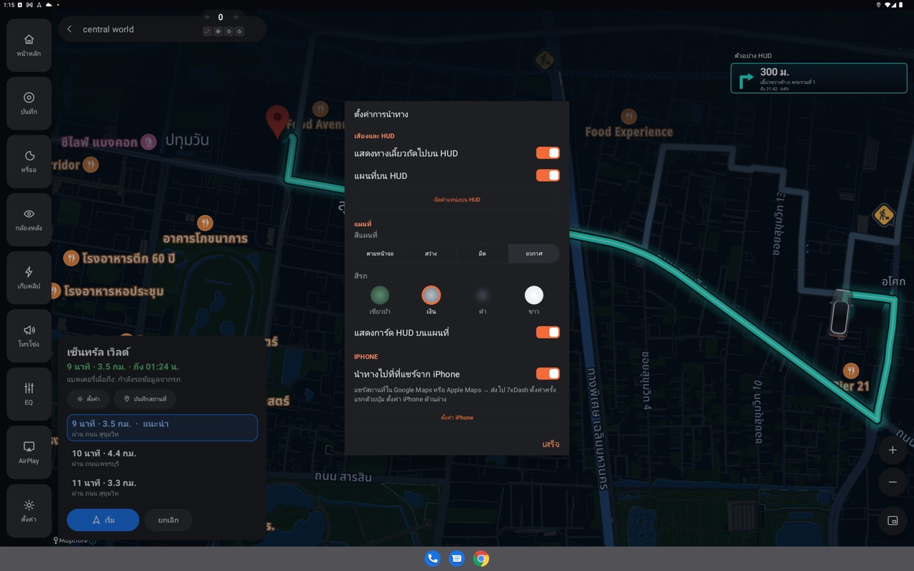
*ตั้งค่าการนำทาง: เสียงและ HUD, แผนที่, iPhone*


| หมวด | ตั้งค่า | ตัวเลือก |
|---|---|---|
| เสียงและ HUD | แสดงทางเลี้ยวถัดไปบน HUD | เปิด/ปิด |
| | แผนที่บน HUD | เปิด/ปิด |
| | จัดตำแหน่งบน HUD | (เฉพาะหน้าเต็มจอ) |
| | แสดงการ์ด HUD บนแผนที่ | เปิด/ปิด (เฉพาะหน้าเต็มจอ) |
| แผนที่ | สีแผนที่ | ตามหน้าจอ, สว่าง, มืด, อวกาศ |
| | สีรถ | เขียวป่า, เงิน, ดำ, ขาว (สีไอคอนรถบนแผนที่) |
| iPhone | นำทางไปที่ที่แชร์จาก iPhone | เปิด/ปิด |
| | ตั้งค่า iPhone | QR สำหรับตั้งคำสั่งลัด (เฉพาะหน้าเต็มจอ) |

สีแผนที่ **ตามหน้าจอ** จะเปลี่ยนตามโหมดกลางวัน/กลางคืนของจอรถ **อวกาศ** เป็นเมืองยามค่ำคืน ตึกมืดที่ฐานและสว่างขึ้นไปทางยอด

---

## ใช้กับปุ่มลัดและระบบอัตโนมัติ

**ปุ่มลัด** (ตั้งได้ในการ์ด ปุ่มลัด, สติกเกอร์ หรือ แผงปุ่มลัด)
- **เปิด / ปิดแผนที่ลอย**
- **ซูมเข้าแผนที่บน HUD**, **ซูมออกแผนที่บน HUD**, **สลับซูมแผนที่บน HUD: ปกติ / ไกล**

**ระบบอัตโนมัติ**
- คำสั่ง **นำทางไปที่** [สถานที่ที่บันทึกไว้]: เริ่มนำทางทันทีโดยไม่ต้องกด เริ่ม ถ้ามีทริปอยู่แล้วจะไม่แทรก
- เหตุการณ์ **ถึง** / **ออกจาก** สถานที่ ใช้สถานที่ชุดเดียวกับการนำทาง

ตัวอย่าง:
```
ออกจาก บ้าน | วันทำงาน → นำทางไปที่ ที่ทำงาน
ออกจาก ที่ทำงาน | วันทำงาน → นำทางไปที่ บ้าน · คำสั่งปุ่มลัด: เปิด / ปิดแผนที่ลอย
ความเร็วถึง 100 กม./ชม. → คำสั่งปุ่มลัด: สลับซูมแผนที่บน HUD
```
ดูเพิ่มใน [คู่มือระบบอัตโนมัติ](automation.md#เดินทางประจำวัน)

---

## ตั้งค่า iPhone ให้ส่งที่หมายมาที่รถ

ทำครั้งเดียว iPhone ต้องอยู่บน Wi-Fi ของรถ ซึ่ง **CarPlay แบบไร้สาย** ทำให้อยู่แล้ว (ต่อสายจะใช้ไม่ได้)

1. เชื่อม CarPlay แบบไร้สาย
2. หน้านำทาง → **ตั้งค่า** → **ตั้งค่า iPhone** สแกน QR ด้วยกล้อง iPhone

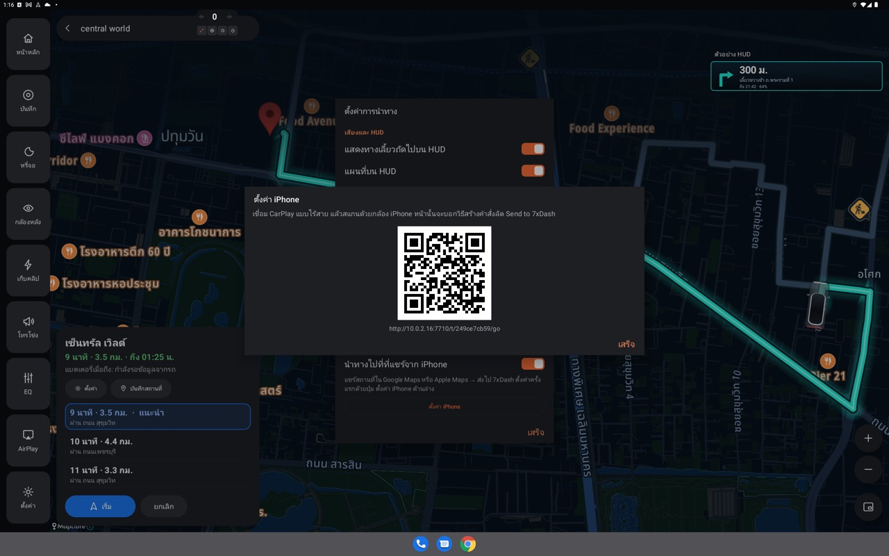
*ตั้งค่า iPhone: สแกน QR นี้ด้วยกล้อง iPhone (ที่อยู่จะต่างกันในแต่ละรถ)*

3. หน้าเว็บที่เปิดขึ้นมาใช้ส่งที่หมายได้เลย (วางลิงก์หรือพิมพ์ชื่อ แล้วกด **ส่งไป 7xDash**)
   แนะนำ: แชร์ → เพิ่มไปยังหน้าจอโฮม เพื่อเปิดในแตะเดียว

**สร้างคำสั่งลัด Send to 7xDash** (เร็วกว่า ส่งจากเมนูแชร์ของแอปแผนที่ได้เลย)
1. เปิดแอป Shortcuts แตะ + แล้วตั้งชื่อว่า Send to 7xDash
2. แตะปุ่ม ⓘ แล้วเปิด Show in Share Sheet
3. เพิ่มคำสั่ง Get Contents of URL แล้ววางที่อยู่ที่หน้าเว็บให้ (กดค้างเพื่อคัดลอก) เป็น URL
4. แตะลูกศรของคำสั่งนั้น: Method เป็น POST, Request Body เป็น Form, เพิ่มช่อง Text ชื่อ `link` ค่าเป็น Shortcut Input
5. วิธีใช้: ใน Google Maps หรือ Apple Maps เปิดที่หมาย แตะแชร์ แล้วเลือก Send to 7xDash

---

## แก้ปัญหา

| อาการ | สาเหตุ / วิธีแก้ |
|---|---|
| "กำลังรอ GPS จากรถ…" นาน | รถยังไม่มีสัญญาณ GPS (ในอาคาร ลานจอดใต้ดิน) ขับออกที่โล่ง |
| "ไม่มีอินเทอร์เน็ต: ติดต่อ TomTom ไม่ได้" | เช็กเน็ตของรถ หรือเปิดฮอตสปอตมือถือให้จอรถ |
| "TomTom ไม่พบถนนไปยังที่นั่น" | จุดที่ปักอยู่กลางน้ำ ในอาคาร หรือไม่มีถนนเข้าถึง ปักใกล้ถนนขึ้น |
| "บิลด์นี้ไม่มีคีย์ TomTom" | บิลด์เองโดยไม่ใส่ `TOMTOM_API_KEY` ใช้บิลด์จาก GitHub Releases |
| ไม่มีแผนที่ แต่ยังนำทางได้ | แผนที่ต้องใช้คีย์ TomTom การนำทางทีละจุดยังทำงาน |
| กดหน้าต่างลอยแล้วไม่ขึ้น | อนุญาต "แสดงทับแอปอื่น" ให้ 7xDash แล้วกดอีกครั้ง |
| ไม่มีการ์ดบน HUD | เปิด แสดงทางเลี้ยวถัดไปบน HUD และตรวจว่าจัดตำแหน่งไม่ได้อยู่นอกจอ (จัดตำแหน่งบน HUD → คืนค่าเดิม) |
| ส่งจาก iPhone แล้วไม่มีอะไรเกิดขึ้น | iPhone ต้องอยู่บน Wi-Fi ของรถ (CarPlay ไร้สาย) และเปิด นำทางไปที่ที่แชร์จาก iPhone |
| "ได้รับข้อมูลจากโทรศัพท์ แต่หาสถานที่ไม่เจอ" | ลิงก์ไม่มีพิกัดหรือชื่อที่ค้นได้ ลองแชร์จากหน้าสถานที่ (ไม่ใช่หน้าเส้นทาง) |
| แบตเมื่อถึงขึ้น "กำลังรอข้อมูลจากรถ" | รถยังไม่ส่งแบตเตอรี่/ระยะวิ่งที่เหลือ รอสักครู่หลังสตาร์ท |
